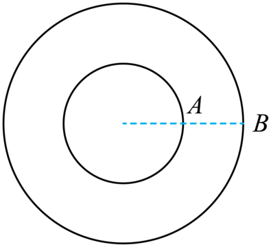

# Physics - 题目 1869

**ID**: 355b316b84564a99adc44e300880befb
**年级**: Grade 12
**难度**: Medium-Hard
**题型**: Multiple-select

## 题目
如图所示，某星球赤道上的A点有一卫星观测站，高空中有一探测卫星B，其轨道与赤道共面。​​​​​​​‌探测卫星B的绕行方向与该星球自转方向相反，角速度为该星球自转角速度的2倍。已知该星球半径为 $R$ ，高空探测卫星B距星球表面的高度也为 $R$ ，星球表面两极的重力加速度为 $g$ ，下列说法正确的是（      ）

## 解答

1. 由万有引力提供向心力 $G\frac {Mm}{r{^{2}}}=ma$ ， $r=2R$ ，黄金代换式 $GM=gR{^{2}}$ ，联立解得 $a=\frac {g}{4}{\rm ，A}$ 正确；由 $G\frac{Mm}{{\left(2R\right)^{2}}}=m{\omega }^{2}×2R$ ，解得卫星的角速度为 $\omega =\sqrt{\frac{GM}{{\left(2R\right)^{3}}}}$ ，则该星球自转的角速度为 ${\omega }_{0}=\frac{1}{2}\sqrt{\frac{GM}{{\left(2R\right)^{3}}}}$ ，该星球自转角速度与其同步卫星角速度相同 $G\frac {Mm}{r{^{2}}}=mω{{}_{0}}{^{2}}r$ ，联立解得 $r=2\sqrt[3]{4}R{\rm ，B}$ 正确；由绕行方向相反，则卫星与观测站下一次相遇满足 $ωt+ω{{}_{0}}t=2π$ ，解得时间为 $t=\frac{2\pi }{\sqrt{\frac{GM}{{\left(2R\right)^{3}}}}+\frac{1}{2}\sqrt{\frac{GM}{{\left(2R\right)^{3}}}}}$ ，代入黄金代换式可解得 $t=\frac {8{\rm{π}}}{3}\sqrt {\frac {2R}{g}}{\rm ，C}$ 错误；如下图所示，由几何关系可得，卫星相对观测站转过的角度为 $\frac {2{\rm{π}}}{3}$ ，则卫星观测站能持续监测探测卫星的时间最长为 $t=\frac{\frac{2\pi }{3}}{\sqrt{\frac{GM}{{\left(2R\right)^{3}}}}+\frac{1}{2}\sqrt{\frac{GM}{{\left(2R\right)^{3}}}}}=\frac{8\pi }{9}\sqrt{\frac{2R}{g}}{\rm ，D}$ 错误。
2. 

## 知识点

**中文**:
  - “火星凌日”问题
  - 万有引力定律问题的分析与计算

**English**:
  - 'Mars Transit' Problems
  - Analysis and Calculation of Gravitation Problems

---
