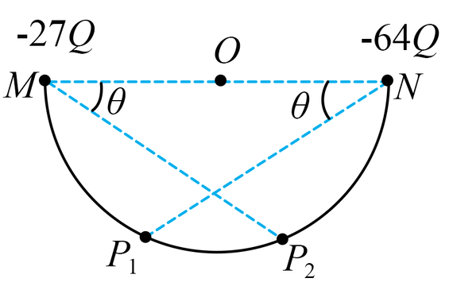

# Physics - 题目 2247

**ID**: 35b520a8490d4fbfaaf622fd302f44c2
**年级**: Grade 12
**难度**: Medium-Hard
**题型**: Multiple-select

## 题目
如图所示，真空中两个负点电荷 $Q{{}_{1}}=-27Q、Q{{}_{2}}=-64Q$ 分别位于某半圆弧的两个端点 $M、N$ 处， $NP{{}_{1}}、MP{{}_{2}}$ 与直径 $MN$ 间夹角 $θ$ 均为 $37{}\degree $ 。​​​​​​​‌已知在正点电荷Q电场中，若取无穷远处电势 $φ=0$ ，距其为r处的电势为 $φ=\frac {kQ}{r}$ ，式中k为静电力常量。则以下说法正确的是（      ）

## 解答

1. 设圆弧MN上一点P与M点连线与MN的夹角为α，若该点的合场强方向沿半径方向，则 ${\rm{t}}{\rm{a}}{\rm{n}}α=\frac {E{{}_{N}}}{E{{}_{M}}}=\frac {\frac {k\cdot 64Q}{(2R\sin α){^{2}}}}{\frac {k\cdot 27Q}{(2R{\cos}α){^{2}}}}$ ，解得 ${\tan}α=\frac {4}{3}$ ，即 $α=53{^{\circ }}$ ，即该点即为P_{1}点；假设某一带负电的粒子从M点沿圆弧MN运动，则只有电场力做功，则电势能和动能之和守恒，粒子在P点时合力为零，加速度为零，速度最大，动能最大，则电势能最小， 则P点电势最高，即圆弧 $MN$ 上电势最高点为 $P{{}_{1}}$ 点，沿圆弧从 $P{{}_{1}}$ 到 $P{{}_{2}}$ 点电势一直降低，距离负电荷越近电势越低，可知P_{2}不是电势最低的点，选项AD正确，B错误； $P{{}_{1}}$ 点场强 $E{{}_{P1}}=\sqrt {[\frac {k\cdot 64Q}{(2R\sin 53{^{\circ }}){^{2}}}]{^{2}}+[\frac {k\cdot 27Q}{(2R{\cos}53{^{\circ }}){^{2}}}]{^{2}}}=\frac {\sqrt {8425}kQ}{2R}$ ，则P_{2}点场强 $E{{}_{P2}}=\sqrt {[\frac {k\cdot 64Q}{(2R\sin 37{^{\circ }}){^{2}}}]{^{2}}+[\frac {k\cdot 27Q}{(2R{\cos}37{^{\circ }}){^{2}}}]{^{2}}}\approx \frac {\sqrt {12516}kQ}{2r}>E{{}_{P1}}$ ，可知 $P{{}_{1}}$ 点的场强小于 $P{{}_{2}}$ 点的场强，选项C正确。

## 知识点

**中文**:
  - 非点电荷的电场强度的计算与叠加

**English**:
  - Calculation and Superposition of Non-Point Charge Fields

---
