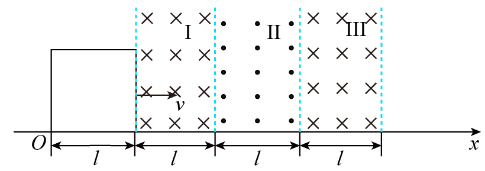

# Physics - 题目 2751

**ID**: 370f9c2dd018427a977bb9416eb0b38e
**年级**: Grade 12
**难度**: Medium-Hard
**题型**: Multiple-select

## 题目
如图所示，边长为 $l$ 、电阻为 $R$ 的正方形导线框沿 $x$ 轴正方向运动。​​​​​​​‌在外力 $F$ 作用下以速度 $v$ 匀速穿过三个宽度均为 $l$ 的匀强磁场区域Ⅰ、Ⅱ、Ⅲ，已知三个区域中磁场的磁感应强度大小均为 $B$ ，Ⅰ、Ⅱ、Ⅲ区域中的磁场方向分别为垂直纸面向里、向外和向里。若以磁感线垂直纸面向里时穿过线框的磁通量 $Φ$ 为正，产生的电流沿顺时针方向的电动势 $E$ 为正，外力 $F$ 向右为正，从线框刚进入磁场时开始计时，则下列反映线框中的磁通量 $Φ$ 、感应电动势 $E$ 、外力 $F$ 和线框的电功率 $P$ 随时间变化的图象正确的是（      ）。

## 解答

1. 在线框进入磁场区域Ⅰ的过程中，穿过线框的磁通量
2. $Φ=Blvt\propto t$
3. 所以在 $0\sim \frac {l}{v}$ 时间内，磁通量 $Φ$ 随时间 $t$ 均匀增加，由
4. $E=Blv$
5. 可知在 $0\sim \frac {l}{v}$ 时间内电动势为定值，电流方向为逆时针，所以电动势为负值，因感应电流
6. $I=\frac {E}{R}$
7. 故
8. $F=F{{}_{安}}=BIl=\frac {B{^{2}}l{^{2}}}{R}v$
9. 在此段时间内也为定值，且方向向右，故为正，功率
10. $P=I{^{2}}R$
11. 同样为定值。
12. 同理，在 $\frac {l}{v}\sim \frac {2l}{v}$ 时间内， $Φ$ 先逐渐减小到零再反向增大，电动势 $E$ 、电流 $I$ 为正值且均变成原来的两倍，外力 $F$ 、功率 $P$ 变为原来的四倍。
13. 在 $\frac {2l}{v}\sim \frac {3l}{v}$ 时间内， $Φ$ 从负的最大逐渐减小到零再变为正的最大，电动势 $E$ 为负值且是 $0\sim \frac {l}{v}$ 时间内电动势的两倍，外力和功率仍与 $\frac {l}{v}\sim \frac {2l}{v}$ 时间内大小相同。
14. 在 $\frac {3l}{v}\sim \frac {4l}{v}$ 时间内，磁通量 $Φ$ 逐渐减小，外力 $F$ 、功率 $P$ 与 $0\sim \frac {l}{v}$ 时间内大小相同，电动势与 $0\sim \frac {l}{v}$ 时间内大小相同但方向相反。
15. 故选BC。

## 知识点

**中文**:
  - 电磁感应定律中的图像问题
  - 线框模型

**English**:
  - Graph Problems in EM Induction
  - Wire Frame Model

---
