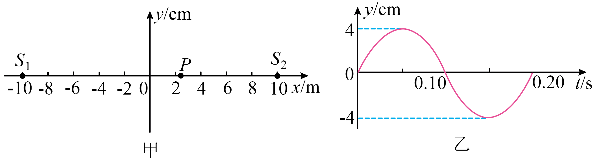

# Physics - 题目 736

**ID**: 394a6dc972974db19e66706a42f5986e
**年级**: Grade 12
**难度**: Medium-Hard
**题型**: Multiple-select

## 题目
如图甲所示，某均匀介质中两波源 $S{{}_{1}}、S{{}_{2}}$ 形成的两列简谐横波均沿x轴传播，波速 $v=20{\rm{m}}/{\rm{s}}$ 。​​​​​​​‌两波源的位置坐标分别为 $x{{}_{1}}=-10{\rm{m}}$ 和 $x{{}_{2}}=10{\rm{m}}，t=0$ 时刻两波源同时开始振动，振动图像均如图乙所示，质点P的平衡位置坐标 $x=2.5{\rm{m}}$ ，下列说法正确的是（      ）

## 解答

1. A．由图乙可知波源的振动周期 $T=0.2{\rm{s}}$ ，两列波的波长 $λ=vT=4{\rm{m}}$ ，波源 $S{{}_{1}}$ 形成的波传播到质点 $P$ 用时 $t{{}_{1}}=\frac {12.5}{20}{\rm{s}}=0.625{\rm{s}}$ ，波源 $S{{}_{2}}$ 形成的波传播到质点 $P$ 用时 $t{{}_{2}}=\frac {7.5}{20}{\rm{s}}=0.375{\rm{s}}$ ，得出 $t=0.475{\rm{s}}$ 时只有波源 $S{{}_{2}}$ 形成的波传播到质点 $P$ ，则 $\Delta t=0.475{\rm{s}}-0.375{\rm{s}}=0.1{\rm{s}}$ ，则质点 $P$ 处于平衡位置沿 $y$ 轴负方向运动，A错误；
2. B． $0\sim 0.625{\rm{s}}$ 时间内，质点 $P$ 振动了 ${\rm{Δ}}t=\left ({0.625-0.375}\right ){\rm{s}}=0.25{\rm{s}}$ ，经过的路程为 $\frac {0.25}{0.2}\times 4A=20{\rm{c}}{\rm{m}}{\rm ，B}$ 正确；
3. C．若以0.625s开始计时，波源 $S{{}_{1}}$ 引起的质点 $P$ 的振动方程 $y{{}_{1}}=4{\rm{s}}{\rm{i}}{\rm{n}}\left ({10{\rm{π}}t}\right ){\rm{c}}{\rm{m}}$ ，波源 $S{{}_{2}}$ 引起的质点 $P$ 的振动方程为 $y{{}_{2}}=4{\rm{s}}{\rm{i}}{\rm{n}}\left ({10{\rm{π}}t+\frac {{\rm{π}}}{2}}\right ){\rm{c}}{\rm{m}}$ ，则质点 $P$ 的振动方程为 $y=y{{}_{1}}+y{{}_{2}}=4\sqrt {2}{\rm{s}}{\rm{i}}{\rm{n}}\left ({10{\rm{π}}t+\frac {{\rm{π}}}{4}}\right ){\rm{c}}{\rm{m}}$ ，可知质点 $P$ 的振幅为 $4\sqrt {2}{\rm{c}}{\rm{m}}{\rm ，C}$ 正确；
4. D． $0.625\sim 0.825{\rm{s}}$ 时间内正好经历了一个周期0.2s，则质点 $P$ 经过的路程为 $4A=4\times 4\sqrt {2}{\rm{c}}{\rm{m}}=16\sqrt {2}{\rm{c}}{\rm{m}}$ ，则 $0\sim 0.825{\rm{s}}$ 时间内，经过的总路程为 $\left ({20+16\sqrt {2}}\right ){\rm{c}}{\rm{m}}{\rm ，D}$ 错误。选BC。

## 知识点

**中文**:
  - 振幅、周期、频率、相位和波长及其计算
  - 简谐运动中的位移与路程问题
  - 简谐运动的函数与图像

**English**:
  - Calculation of Amplitude, Period, Frequency, Phase, and Wavelength
  - Displacement and Distance in SHM
  - Functions and Graphs of SHM

---
