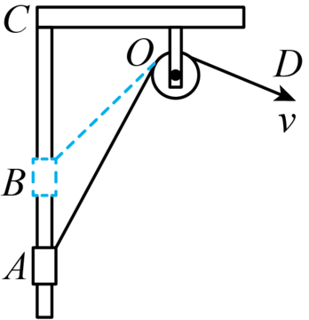

# Physics - 题目 2443

**ID**: 3a94ad018f824e5492344a21a608022a
**年级**: Grade 12
**难度**: Medium-Hard
**题型**: Multiple-select

## 题目
如图所示，固定竖直杆上套着一个质量为m的小滑块（视为质点），用轻绳系着滑块绕过小定滑轮（大小不计），另一端以大小为v的速度匀速运动，使滑块沿竖直杆上升，先后经过A、B两点。​​​​​​​‌滑轮边缘与轻绳相切于O点。O点到竖直杆的距离为L，∠OAC= 30°，∠OBC=45°，重力加速度大小为g，不计一切摩擦。 下列说法正确的是（      ）

## 解答

1. AB．滑块经过A点时对速度进行分解，如图所示
2. 
3. 则滑块经过A点时的速度为
4. $v{{}_{A}}=\frac {v}{{\cos}30{^{\circ }}}=\frac {2\sqrt {3}v}{3}$
5. 同理，滑块经过B时的速度为
6. $v{{}_{B}}=\frac {v}{{\cos}45{^{\circ }}}=\sqrt {2}v$
7. 滑块经过A、B两点时的速度大小之比为
8. $v{{}_{A}}:v{{}_{B}}=\sqrt {6}:3$
9. 故A错误，B正确；
10. CD．滑块从A点运动到B点的过程中上升的高度为
11. $h=\frac {L}{{\tan}30{^{\circ }}}-\frac {L}{{\tan}45{^{\circ }}}=(\sqrt {3}-1)L$
12. 根据动能定理，可得
13. $W{{}_{F}}-mgh=\frac {1}{2}mv{{}_{B}}{^{2}}-\frac {1}{2}mv{{}_{A}}{^{2}}$
14. 联立方程，解得
15. $W{{}_{F}}=(\sqrt {3}-1)mgL+\frac {1}{3}mv{^{2}}$
16. 故C正确，D错误。
17. 故选BC。

## 知识点

**中文**:
  - 应用动能定理求解变力做功问题

**English**:
  - Solving Work Done by Variable Force

---
