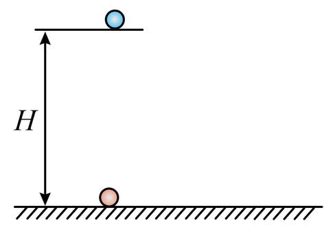

# Physics - 题目 1355

**ID**: 3ab13730ff1a47248d260c86260411f9
**年级**: Grade 12
**难度**: Medium-Hard
**题型**: Multiple-select

## 题目
如图所示，在竖直方向同一直线上，小球 ${\rm{A}}$ 从距地面高度 $H=5{\rm{m}}$ 处自由下落，同时小球 ${\rm{B}}$ 以初速度 $v{{}_{0}}$ 从地面竖直上抛。​​​​​​​‌忽略空气阻力，重力加速度为 $g=10{\rm{m}}/{\rm{s}}{^{2}}$ ，小球与地面碰撞后速度等大反向。关于 ${\rm{A}}$ 、 ${\rm{B}}$ 相遇的时间和地点，下列说法正确的是（      ）

## 解答

1. 若两球在B与地面碰撞前两球相遇，设两球从开始运动到相遇经历时间为t，则有 $\frac {1}{2}gt{^{2}}+v{{}_{0}}t-\frac {1}{2}gt{^{2}}=H$ ，可得 $t=\frac {H}{v{{}_{0}}}$ 若两球恰好第一次在地面相遇时，则有 $H=\frac {1}{2}gt{^{2}}$ ，求得 $t=\sqrt {\frac {2H}{g}}$ ，对B小球，则有 $0=v{{}_{0}}t-\frac {1}{2}gt{^{2}}$ ，求得B小球竖直上抛的初速度为 $v{{}_{0}}=\sqrt {\frac {gH}{2}}=5{\rm{m}}{\rm{/}}{\rm{s}}{\rm ，A}$ 正确B错误；设B第n次到达最高点与A相碰（n取1.2.3…），则有 $\frac {1}{2}g\left ({\frac {\left ({2n-1}\right )v{{}_{0}}}{g}}\right ){^{2}}=H-\frac {v{{}_{0}}{^{2}}}{2g}$ ，得 $v{{}_{0}}=\sqrt {\frac {2gH}{{\left({2n-1}\right)^{2}}+1}}$ ，当B第n次落地时与A相碰，则有 $\frac {1}{2}g{\left({\frac {2nv{{}_{0}}}{g}}\right)^{2}}=H$ ，解得 $v{{}_{0}}=\sqrt {\frac {gH}{2n{^{2}}}}$ ，因为 $\sqrt {\frac {gH}{2n{^{2}}}}⩽\sqrt {\frac {gH}{2n}}<v{{}_{0}}<\sqrt {\frac {gH}{2n-1}}⩽\sqrt {\frac {2gH}{{\left({2n-1}\right)^{2}}+1}}$ ，所以 ${\rm{A}}$ 、 ${\rm{B}}$ 在 ${\rm{B}}$ 第 $n$ 次上升的途中相遇，C正确D错误。

## 知识点

**中文**:
  - 自由落体运动和竖直上抛运动的相遇问题

**English**:
  - Encounter Problems: Free Fall and Vertical Throw

---
