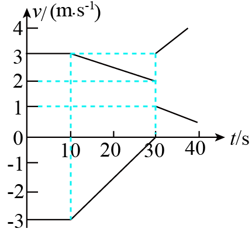

# Physics - 题目 947

**ID**: 48100293ee674285a76ad27b46d5648e
**年级**: Grade 12
**难度**: Medium-Hard
**题型**: Multiple-select

## 题目
在光滑水平面上，小球A、B（可视为质点）沿同一直线相向运动，A球质量为1 kg，B球质量大于A球质量．如果两球间距离小于L时，两球之间会产生大小恒定的斥力，大于L时作用力消失．两球运动的速度一时间关系如图所示，下列说法正确的是​​​​​​​‌

## 解答

1. 当两球间距小于L时，两球均做匀减速运动，因B球质量大于A球质量可知B球加速度小于A球的加速度，由v-t图像，可知： $a{{}_{B}}=\frac {2-3}{20}{\rm{m}}{\rm{/}}{\rm{s}}{{}^{{\rm{2}}}}=-0.05{\rm{m}}{\rm{/}}{\rm{s}}{{}^{{\rm{2}}}}$ ； $a{{}_{A}}=\frac {0-\left ({-3}\right )}{20}{\rm{m}}{\rm{/}}{\rm{s}}{{}^{{\rm{2}}}}=0.15{\rm{m}}{\rm{/}}{\rm{s}}{{}^{{\rm{2}}}}$ ；由牛顿第二定律： $F=m{{}_{A}}a{{}_{A}}=m{{}_{B}}a{{}_{B}}$ ，解得m_{B}=3m_{A}=3kg，F=0.15N，选项A错误，B正确； 由图像可知，AB在30s时刻碰前速度：v=0，v_{B}=2m/s；碰后： $v^{′}{{}_{A}}$ =3m/s， $v^{′}{{}_{B}}$ =1m/s，因 $ΔE=\frac {1}{2}m{{}_{B}}v{{}_{B}^{2}}-(\frac {1}{2}m{{}_{A}}v{{}_{A}^{^{′}2}}+\frac {1}{2}m{{}_{B}}v{{}_{B}^{^{′}2}})=0$ 可知t=30 s时，两球发生弹性碰撞，选项C错误；由图像可知，两部分阴影部分的面积应该相等且都等于L，可知最终B球速度为零，选项D正确.
2. 

## 知识点

**中文**:
  - 弹性碰撞和非弹性碰撞

**English**:
  - Elastic and Inelastic Collisions

---
