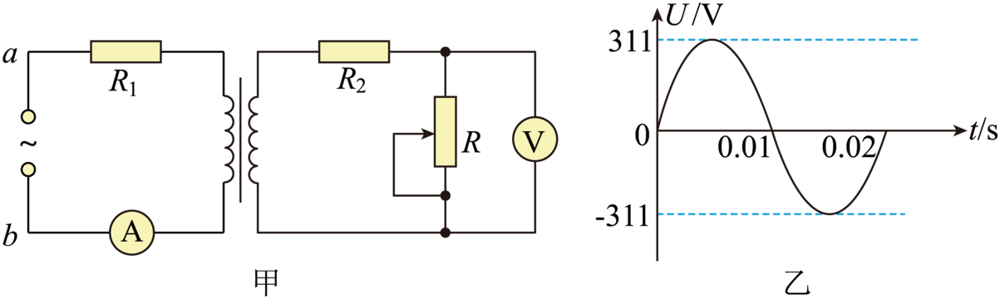

# Physics - 题目 1494

**ID**: 491dd6e3fba94a31aa958d7cb4bf6144
**年级**: Grade 12
**难度**: Medium-Hard
**题型**: Multiple-select

## 题目
如图甲所示，理想变压器原、副线圈匝数比为 $2:1$ ，电路中 $R_{1}=100Ω$ ， $R_{2}=15Ω$ ，滑动变阻器 $R$ 的最大阻值为 $15Ω$ ，图中电表均为理想交流电表，a，b间的电压如图乙所示，下列说法正确的是（      ）​​​​​​​‌

## 解答

1. A．由图乙可知该交流电的周期为
2. $T=0.02{\rm{s}}$
3. 频率为
4. $f=\frac {1}{T}=50{\rm{H}}{\rm{z}}$
5. A正确；
6. BC．滑动变阻器滑片向下滑动时，滑动变阻器接入电阻变大，滑动变阻器两端电压升高，电压表示数增大，用电电流减小原线圈所在电路电流也减小，电流表示数减小，B正确，C错误；
7. D．由图乙可知a，b间的电压有效值为
8. $U=\frac {311}{\sqrt {2}}{\rm{V}}=220{\rm{V}}$
9. 滑动变阻器接入电阻最大时，电流表的示数为I，由理想变压器电流电压关系可知
10. $U=U_{1}+IR_{1}$
11. $\frac {1}{2}U_{1}=2I(R+R_{2})$
12. 解得
13. $I=1{\rm{A}}$
14. D正确；
15. 故选ABD。

## 知识点

**中文**:
  - 交变电流的周期、频率
  - 正弦式交变电流的公式及图像
  - 交变电流的峰值和有效值
  - 变压器的构造和原理
  - 理想变压器原、副线圈两端的电压、功率、电流关系及其应用

**English**:
  - Period and Frequency of AC
  - Formulas and Graphs of Sinusoidal AC
  - Peak and RMS Values of AC
  - Construction and Principle of Transformers
  - Voltage, Power, Current Relations in Ideal Transformers

---
