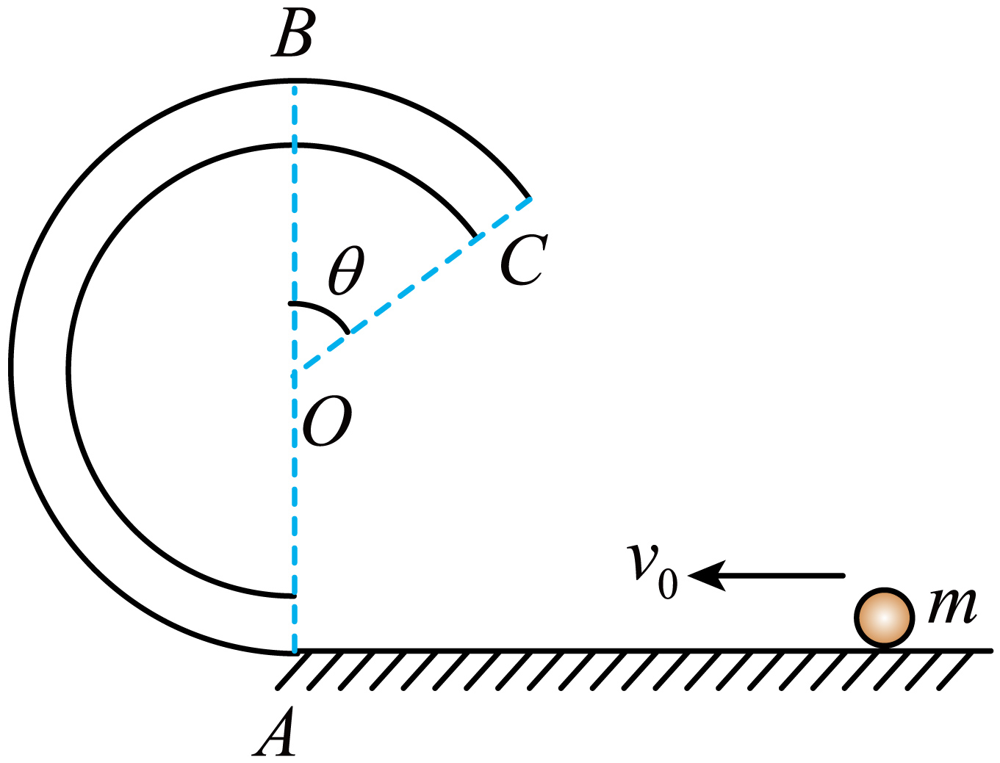

# Physics - 题目 744

**ID**: 4ae890d650ff419b8495288761fdffc7
**年级**: Grade 12
**难度**: Medium-Hard
**题型**: Multiple-select

## 题目
如图所示，内壁光滑的细圆轨道 $ABC$ 竖直固定放置在光滑水平面上的 $\mathrm{A}$ 点，竖直直径 $AB$ 与倾斜半径 $OC$ 间的夹角为 $θ$ ，质量为 $m$ 的小球（可视为质点）在光滑水平面上获得水平向左的速度 $v{{}_{0}}$ ，然后从 $\mathrm{A}$ 点切入圆弧轨道，重力加速度为 $g$ ，空气阻力忽略不计，下列说法正确的是（      ）​​​​​​​‌

## 解答

1. 若小球刚好能到达 $B$ 点，则小球在 $B$ 点的速度为0，小球在 $B$ 点处于二力平衡状态，既不是失重状态也不是超重状态，故A错误；小球从 $\mathrm{A}$ 到 $B$ 由机械能守恒定律可得 $mg\times 2R=$  $\frac {1}{2}mv{{}_{0}^{2}}$ ，解得 $R=\frac {v{{}_{0}^{2}}}{4g}$ ，故B正确；把小球在 $C$ 点的速度 $v$ 分别沿水平方向和竖直方向分解，则有 $v{{}_{x1}}=v{\rm{c}}{\rm{o}}{\rm{s}}θ，v{{}_{y1}}=v{\rm{s}}{\rm{i}}{\rm{n}}θ$ ，重力的功率为 $P{{}_{{\rm{G}}{{1}}}}=mgv{{}_{y1}}=mgv{\rm{s}}{\rm{i}}{\rm{n}}θ$ ，故C错误；由机械能守恒可得小球落回水平面的瞬时速度大小为 $v{{}_{0}}$ ，把 $v{{}_{0}}$ 分别沿着水平方向和竖直方向分解，水平方向的分速度大小为 $v{{}_{x}}=v{{}_{x1}}=v{\rm{c}}{\rm{o}}{\rm{s}}θ$ ，则竖直方向的分速度大小为 $v{{}_{y}}=\sqrt {v{{}_{0}^{2}}-v{{}_{x}^{2}}}=\sqrt {v{{}_{0}^{2}}-v{^{2}}{\rm{c}}{\rm{o}}{\rm{s}}{^{2}}θ}$ ，则重力的瞬时功率为 $P{{}_{{\rm{G}}}}=mgv{{}_{y}}=mg\times \sqrt {v{{}_{0}^{2}}-v{^{2}}{\rm{c}}{\rm{o}}{\rm{s}}{^{2}}θ}$ ，故D正确。

## 知识点

**中文**:
  - 单一物体机械能守恒定律的应用

**English**:
  - Applications for Single Body

---
