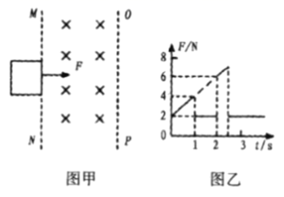

# Physics - 题目 91

**ID**: 4c552f6abf364b4bafbb6ccd56f7b3f2
**年级**: Grade 12
**难度**: Medium-Hard
**题型**: Multiple-select

## 题目
如图甲所示，在MN、OP之间存在一匀强磁场，t=0 时，一正方形光滑金属线框在水平向右的外力F作用下紧贴MN从静止开始做匀加速运动，外力F随时间变化的图线如图乙所示。​​​​​​​‌已知线框的质量m=1kg，电阻R=2Ω。则（      ）

## 解答

1. A．当 $t=0$ 时线框的速度为零，没有感应电流，线框不受安培力，根据牛顿第二定律，线框的加速度
2. $a=\frac {F}{m}=2{\rm{m}}{\rm{/}}{\rm{s}}{^{{\rm{2}}}}$
3. 磁场的宽度等于线框在 $0\sim 2{\rm{s}}$ 内的位移
4. $d=\frac {1}{2}at{{}_{1}}{^{2}}=\frac {1}{2}\times 2\times 2{^{2}}{\rm{m}}=4{\rm{m}}$
5. A正确；
6. B．根据图像 $t=1{\rm{s}}$ 时线框全部进入磁场，进入磁场的位移正好等于线框的边长
7. $L=\frac {1}{2}at{{}_{2}}{^{2}}=1{\rm{m}}$
8. 当线框全部进入磁场的瞬间受到的安培力
9. $F{{}_{安}}{\rm{=}}BIL=\frac {BLBLv}{R}=\frac {B{^{2}}L{^{2}}v}{R}=\frac {B{^{2}}L{^{2}}at{{}_{2}}}{R}$
10. 线框全部进入磁场的瞬间，根据牛顿第二定律得
11. $F{^{^{′}}}-F{{}_{安}}=ma$
12. $4-\frac {B{^{2}}L{^{2}}at{{}_{2}}}{R}=ma$
13. 解得
14. $B=\sqrt {2}{\rm{T}}$
15. B错误；
16. C．线框穿过磁场过程中，通过线框的电荷量
17. $q=IΔt=\frac {ΔΦ}{R}$
18. 线框穿过磁场过程中磁通量的变化量为零，通过线框的电荷量为零，C错误；
19. D．根据动量定理
20. ${\overline{F}}t{{}_{1}}-I{{}_{F{{}_{安}}}}=mv-0=mat{{}_{1}}$
21. $3\times 1{\rm{N}}{\rm{.}}{\rm{s}}-I{{}_{F{{}_{安}}}}=1\times 2\times 1{\rm{N}}{\rm{.}}{\rm{s}}$
22. 解得
23. $I{{}_{F{{}_{安}}}}=1{\rm{N}}{\rm{.}}{\rm{s}}$
24. D正确。
25. 故选AD。

## 知识点

**中文**:
  - 线框模型

**English**:
  - Wire Frame Model

---
