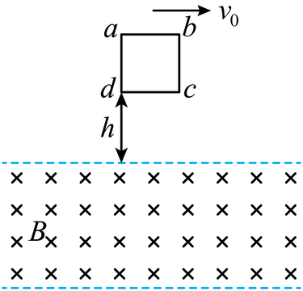

# Physics - 题目 2494

**ID**: 4f7085124c934343b9cda55dc7de64b8
**年级**: Grade 12
**难度**: Medium-Hard
**题型**: Multiple-select

## 题目
如图所示，水平平行边界内有垂直纸面向内的匀强磁场，磁感应强度 $B=2.0{\rm{T}}$ 。​​​​​​​‌正方形单匝金属线框在磁场上方 $h=1.25{\rm{m}}$ 处，以 $5{\rm{m}}{\rm{/}}{\rm{s}}$ 向右水平抛出，下落过程中线框ab边始终与磁场边界平行，ab边进入磁场和离开磁场时竖直方向的分速度均为 $3{\rm{m}}{\rm{/}}{\rm{s}}$ 。线框质量为 $0.1{\rm{k}}{\rm{g}}$ ，边长为0.5m，总阻值为1Ω，不计空气阻力，重力加速度g取 $10{\rm{m}}{\rm{/}}{\rm{s}}{^{{{2}}}}$ 。下列说法正确的是（      ）

## 解答

1. cd边刚进入磁场时竖直方向的分速度为 $v{{}_{y}}=\sqrt {2gh}=5{\rm{m}}/{\rm{s}}$ ，由题意，根据线框进出磁场过程的对称性可知，cd边刚出磁场时竖直方向的分速度也为 $v{{}_{y}}=5{\rm{m}}/{\rm{s}}$ ，从ab边刚进入磁场到cd边刚出磁场的过程中，线框中磁通量不变，感应电流为零，此过程线框自由下落，设匀强磁场区域的高度为H，根据运动学规律有 $v{{}_{y}^{2}}-v{{}_{ab}^{2}}=2g\left ({H-l}\right )$ ，解得 $H=1.3{\rm{m}}{\rm ，A}$ 正确；设线框通过磁场上边界的时间为 $t{{}_{1}}$ ，线框中的平均电流为 $\bar I$ ，根据动量定理有 $\left ({mg-B\bar Il}\right )t{{}_{1}}=mv{{}_{ab}}-v{{}_{y}}$ ，根据电流的定义可知 $t{{}_{1}}$ 时间内通过线框某一截面的电荷量为 $q=\bar It{{}_{1}}$ ，根据法拉第电磁感应定律、闭合电路欧姆定律综合分析可知 $q=\frac {{\overline{E}}}{R}t{{}_{1}}=\frac {Δϕ}{Rt{{}_{1}}}·t{{}_{1}}=\frac {Bl{^{2}}}{R}$ ，联立解得 $t{{}_{1}}=0.3{\rm{s}}$ ，根据运动的对称性可知，线框穿出磁场区域的时间也为 $t{{}_{1}}=0.3{\rm{s}}$ ，线框中没有感应电流，只受到重力作用时，线框下落所用时间为 $t{{}_{2}}=\frac {v{{}_{y}}-v{{}_{ab}}}{g}=0.2{\rm{s}}$ ，则线框通过整个磁场区域所用时间为 $t{{}_{总}}=2t{{}_{1}}+t{{}_{2}}=0.8{\rm{s}}{\rm ，B}$ 正确；线框进入磁场过程中，bc边与ad边受到大小相等、方向相反的安培力的作用，水平方向上受力平衡，做匀速直线运动，则线框进入磁场过程中的水平位移为 $x=v{{}_{0}}t{{}_{1}}=1.5{\rm{m}}{\rm ，C}$ 错误；cd边刚进入磁场时竖直方向的分速度为 $v{{}_{y}}$ ，此时cd边切割磁感线产生的感应电动势为 $E=Blv{{}_{y}}=5{\rm{V}}$ ，线框中的电流为 $I=\frac {E}{R}=5{\rm{A}}{\rm ，\mathit{cd}}$ 边所受安培力大小为 $F=BIl=5{\rm{N}}{\rm ，\mathit{cd}}$ 边克服安培力做功的功率为 $P=Fv{{}_{y}}=25{\rm{W}}{\rm ，D}$ 错误。

## 知识点

**中文**:
  - 线框模型

**English**:
  - Wire Frame Model

---
