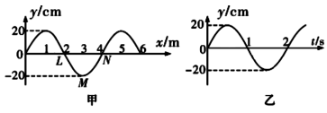

# Physics - 题目 1011

**ID**: 511f7ddbd8ba41369c5db3338e93b6ce
**年级**: Grade 12
**难度**: Medium-Hard
**题型**: Multiple-select

## 题目
一列横波在某介质中沿x轴传播，如图甲所示为t＝1.​​​​​​​‌0 s时的波形图，如图乙所示为x＝2.0m处的质点L的振动图象，已知图甲中M、N两点的平衡位置分别位于x_{M}＝3.0m、x_{N}＝4.0m，则下列说法正确的是．

## 解答

1. A. 由振动图象可知质点 $L$ 在 $t=1{\rm{s}}$ 时沿 $y$ 轴负方向运动，结合上下坡法可得该波沿 $x$ 轴负方向运动，故A正确；
2. B. 图甲中质点 $M$ 在最大位移处，速度为零，加速度最大，故B错误；
3. C. 再经过 $t=1.5{\rm{s}}$ 质点 $L$ 与质点 $N$ 分别位于波峰与波谷，位移一个正一个负，故位移不同，故C错误；
4. D. 从 $t=0.5{\rm{s}}$ 时刻到 $t=2.0{\rm{s}}$ 时刻， $M$ 质点振动时间为：
5. $Δt=1.5{\rm{s}}=\frac {3}{4}T$
6. 质点 $M$ 通过的路程为：
7. $S=3A=60{\rm{c}}{\rm{m}}$
8. 故D正确；
9. E. 由图甲可知该波波长为4m，当障碍物尺寸与波长差不多，或比波长小时，会发生明显衍射，故该波在传播的过程中，遇到宽度为1m的障碍物能发生明显的衍射现象，故E正确．

## 知识点

**中文**:
  - 波的图像和振动图像的综合应用

**English**:
  - Integrated Application of Wave and Vibration Graphs

---
