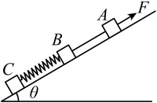

# Physics - 题目 1352

**ID**: 5433c96570b74be8bc647b9ec40a38a1
**年级**: Grade 12
**难度**: Medium-Hard
**题型**: Multiple-select

## 题目
如图所示，A、B、C三个物体分别用轻绳和轻弹簧连接，放置在倾角为θ的光滑斜面上，当用沿斜面向上的恒力F作用在物体A上时，三者恰好保持静止，已知A、B、C三者质量相等，重力加速度为g．下列说法正确的是​​​​​​​‌

## 解答

1. A. 把 $ABC$ 看成是一个整体进行受力分析，有:
2. $F=3mg{\rm{s}}{\rm{i}}{\rm{n}}{\rm{θ}}$
3. 在轻绳被烧断的瞬间， $AB$ 之间的绳子拉力为零，对 $A$ ，由牛顿第二定律得：
4. $F-mg{\rm{s}}{\rm{i}}{\rm{n}}{\rm{θ}}=ma{{}_{A}}$
5. 解得：
6. $a{{}_{A}}=2g{\rm{s}}{\rm{i}}{\rm{n}}{\rm{θ}}$
7. 故A正确；
8. B. 对于 $C$ ，由牛顿第二定律得：
9. $F$_{弹}$=mg{\rm{s}}{\rm{i}}{\rm{n}}{\rm{θ}}$
10. 在轻绳被烧断的瞬间，对于 $B$ ，绳子拉力为零，弹力不变，根据牛顿第二定律：
11. $F$_{弹}$+mg{\rm{s}}{\rm{i}}{\rm{n}}{\rm{θ}}=ma{{}_{B}}$
12. 解得：
13. $a{{}_{B}}=2g{\rm{s}}{\rm{i}}{\rm{n}}{\rm{θ}}$
14. 故B错误；
15. C. 剪断弹簧的瞬间，对于整体 $AB$ ，弹簧弹力为零，根据牛顿第二定律：
16. $F-2mg{\rm{s}}{\rm{i}}{\rm{n}}{\rm{θ}}=2ma{{}_{AB}}$
17. 解得：
18. $a{{}_{AB}}=\frac {1}{2}g{\rm{s}}{\rm{i}}{\rm{n}}{\rm{θ}}$
19. $A$ 的加速度大小：
20. $a{{}_{A}}=a{{}_{AB}}=\frac {1}{2}g{\rm{s}}{\rm{i}}{\rm{n}}{\rm{θ}}$
21. 故C正确；
22. D. 突然撤去外力 $F$ 的瞬间，对于整体 $AB$ ，一起做匀减速直线运动，由牛顿第二定律：
23. $F$_{弹}$+2mg{\rm{s}}{\rm{i}}{\rm{n}}{\rm{θ}}=2ma{{}_{AB}}$
24. 解得：
25. $a{{}_{AB}}=\frac {3}{2}g{\rm{s}}{\rm{i}}{\rm{n}}{\rm{θ}}$
26. $A$ 的加速度大小：
27. $a{{}_{A}}=a{{}_{AB}}=\frac {3}{2}g{\rm{s}}{\rm{i}}{\rm{n}}{\rm{θ}}$
28. 故D错误．

## 知识点

**中文**:
  - 牛顿第二定律求解瞬时突变问题

**English**:
  - Solving Instantaneous Change Problems with Newton's 2nd Law

---
