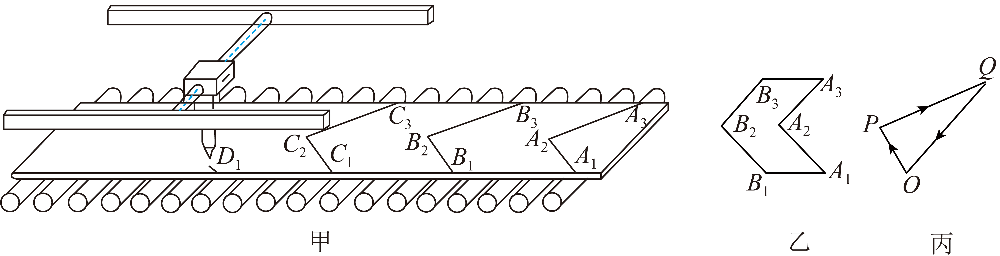

# Physics - 题目 955

**ID**: 58db25838d35401ebcda8bc0b7e5dfec
**年级**: Grade 12
**难度**: Medium-Hard
**题型**: Multiple-select

## 题目
激光器将长钢板切割成一块块“”形小钢板的流程图如图甲所示，切割出的每块小钢板均相同，形状如图乙所示，其中 $\angle A{{}_{1}}A{{}_{2}}A{{}_{3}}=\angle B{{}_{1}}B{{}_{2}}B{{}_{3}}=90{}\degree $ ，且小钢板关于中轴线 $A{{}_{2}}B{{}_{2}}$ 对称。​​​​​​​‌工作时传送带匀速向右运送长钢板，同时控制激光器以恒定的速率移动，将长钢板切割成小块。激光器切割时相对地面的移动轨迹如图丙所示，其中OP和PQ段激光器工作，QO段激光器返程不进行切割，激光器回到O点后就可以择机开始下一次切割了，下列说法正确的是（      ）

## 解答

1. 设传送带的速度大小为 $v{{}_{0}}$ ，激光器的速度大小为 $v$ ，切割 $A{{}_{1}}A{{}_{2}}$ 边时激光器相对传送带的速度大小为 $v{{}_{1}}$ ，切割 $A{{}_{2}}A{{}_{3}}$ 边时激光器相对传送带的速度大小为 $v{{}_{2}}$ ，则相对速度的矢量表达式为 $v{{}_{1}}=v-v{{}_{0}}$ ， $v{{}_{2}}=v-v{{}_{0}}$ ，作出矢量合成示意图如图所示
2. 
3. 由题意可知， $A{{}_{1}}A{{}_{2}}$ 边垂直于 $A{{}_{2}}A{{}_{3}}$ 边，即 $v{{}_{1}}$ 垂直于 $v{{}_{2}}$ ，且 $v{{}_{1}}$ 和 $v{{}_{2}}$ 与水平方向的夹角均为 $45{}\degree $ ，作 $M$ 点关于水平轴的对称点 $M^{′}$ ，由几何关系可知 $∠M^{′}=45{}\degree $ ，根据圆心角为圆周角的2倍可知 $\angle MON=90{}\degree $ ， $OP$ 与 $PQ$ 垂直且与传送带和激光器的移动速率无关，D正确；结合上述可知 $v>v{{}_{0}}$ ，即激光器的速率始终大于传送带的速率，A正确；提高激光器的移动速率可以使激光器更快地回到起点，根据分运动的等时性可知，这一过程中长钢板向右移动的距离（ $A{{}_{1}}B{{}_{1}}$ 长度）将减小，B正确；持小钢板的尺寸不变，即 $A{{}_{1}}B{{}_{1}}$ 长度不变，此时，每小时切割出的小钢板数量由传送带的速率 $v{{}_{0}}$ 和钢板尺寸（ $A{{}_{1}}B{{}_{1}}$ 长度）共同决定，即若小钢板尺寸与传送带速率不变，则每小时切割出的小钢板数量不变，与激光器的速率无关，C错误。

## 知识点

**中文**:
  - 运动的合成与分解

**English**:
  - Composition and Resolution of Motion

---
