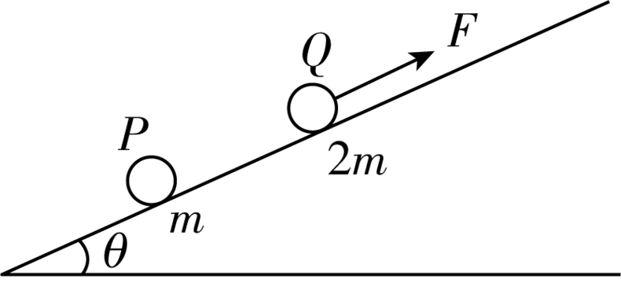

# Physics - 题目 18

**ID**: 599c2357efb5446a911c039dfeff8787
**年级**: Grade 12
**难度**: Medium-Hard
**题型**: Multiple-select

## 题目
如图所示，两长度均为L的通电长直导线P、Q锁定在倾角为θ的光滑斜面上，质量分别为m、2m，两导线中通入的电流大小相等，均为I，重力加速度大小为g，现在导线Q的中点施加一沿斜面向上的拉力F，与此同时对两导线解除锁定，两导线间距离不变并沿斜面向上做匀加速直线运动。​​​​​​​‌下列说法正确的是    	（      ）

## 解答

1. 两导线一起沿斜面向上做匀加速直线运动，Q对P的安培力方向沿斜面向上，故两导线相互吸引，电流方向相同，A错误；对P、Q整体，由牛顿第二定律得F-3mgsinθ=3ma，对P有F_{1}-mgsinθ=ma，联立解得P、Q间的安培力大小为 ${\rm \mathit{F}_{1}=}\frac{1}{3}{\rm \mathit{F}，B}$ 正确；若F=6mgsinθ，则F_{1}=2mgsinθ，撤去外力F瞬间，对P，由牛顿第二定律得2mgsinθ-mgsinθ=ma_{1}，解得a_{1}=gsinθ，对Q，由牛顿第二定律得2mgsinθ+2mgsinθ=2ma_{2}，解得a_{2}=2gsinθ，则a_{1}∶a_{2}=1∶2，C错误；去掉Q后，对P受力分析如图所示，可知，当F_{A}与F_{N}垂直时，F_{A}最小，此时磁感应强度最小，由平衡条件得mgsinθ=B_{min}IL，解得 ${\rm \mathit{B}_{min}=}\frac{mg\sin \theta }{IL}$ ，故要使导线P静止在斜面上，所加磁场的磁感应强度大小满足 ${\rm \mathit{B}≥}\frac{mg\sin \theta }{IL}{\rm ，D}$ 正确。
2. 

## 知识点

**中文**:
  - 安培力作用下的平衡问题
  - 安培力的方向（左手定则）

**English**:
  - Equilibrium under Ampere Force
  - Direction of Ampere Force (Left-Hand Rule)

---
