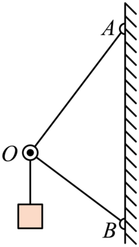

# Physics - 题目 1171

**ID**: 60ba3bea7b164e008958f2a4c14a311e
**年级**: Grade 12
**难度**: Medium-Hard
**题型**: Multiple-select

## 题目
如图所示，轻杆OA与轻杆OB通过光滑铰链安装在竖直墙面上，另一端通过 A铰链连接于O点。​​​​​​​‌已知 $\angle OAB=37{^{\circ }}$ ， $\angle OBA=53{^{\circ }}$ ，铰链质量忽略不计，重力加速度为g。现将一个质量为m的物块通过轻绳悬挂于O点保持静止，下列说法正确的是（      ）

## 解答

1. 对O点受力分析如图1：则有 $F{{}_{{\rm{O}}{\rm{A}}}}=mg{\cos}37{^{\circ }}=\frac {4}{5}mg{\rm ，A}$ 错误；对轻杆OA、OB及重物所组成的系统进行受力分析可知，该系统受到三个外力，分别是竖直墙对A、B两点铰链的作用力及重物重力，由三力平衡可知竖直墙对A、B两点铰链的总作用力方向竖直向上，大小等于 $mg{\rm ，B}$ 正确；若在O点施加从零缓慢增大且水平向左的外力，则O点受力情况如图2.沿两杆方向将mg和F正交分解可得 $F{{}_{{\rm{O}}{\rm{B}}}}=mg{\cos}53{^{\circ }}-{\rm \mathit{F}cos}$  $37{^{\circ }}$ ， $F{{}_{{\rm{O}}{\rm{A}}}}=mg\sin 53{^{\circ }}+F\sin 37{\rm \mathit{F}}$ 缓慢增大时 $F{{}_{{\rm{O}}{\rm{A}}}}$ 一直增大， $F{{}_{{\rm{O}}{\rm{B}}}}$ 先减小后反向增大，C正确；若在O点施加从零缓慢增大且水平向右的外力，则O点受力情况如图3.沿两杆方向将mg和F正交分解可得 $F{{}_{{\rm{O}}{\rm{B}}}}$  $=F{\cos}37{^{\circ }}+mg{\cos}53{^{\circ }}$ ， $F{{}_{{\rm{O}}{\rm{A}}}}=mg\sin 53{^{\circ }}-F\sin 37{^{\circ }}{\rm ，\mathit{F}}$ 缓慢增大时 $F{{}_{{\rm{O}}{\rm{A}}}}$ 先减小后反向增大， $F{{}_{{\rm{O}}{\rm{B}}}}$ 一直增大，D错误。
2. 

## 知识点

**中文**:
  - 用正交分解法分析问题

**English**:
  - Problem Analysis using Orthogonal Decomposition

---
