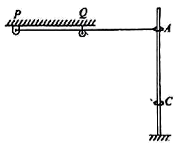

# Physics - 题目 121

**ID**: 658a95bcdac14f8abb95eaa899a187ef
**年级**: Grade 12
**难度**: Medium-Hard
**题型**: Multiple-select

## 题目
如图所示，一劲度系数 $k=\frac {mg}{l}$ 的弹性绳一端系于 $P$ 点，绕过 $Q$ 处的小滑轮，另一端与质量为 $m$ 、套在粗糙竖直固定杆 $\mathrm{A}$ 处的圆环相连， $P$ 、 $Q$ 、 $\mathrm{A}$ 三点等高，弹性绳的原长恰好等于 $PQ$ 间距，圆环与杆间的动摩擦因数为0.5.在竖直向上的外力 $F$ 作用下将滑环从与 $P$ 点等高的 $\mathrm{A}$ 点缓慢移动到 $O$ 点（图中未标出），在 $O$ 点处外力 $F$ 恰好为零。​​​​​​​‌已知 $\mathrm{A}$ 、 $O$ 两点间距为 $\frac {l}{2}$ ，弹性绳受到的拉力与伸长量的关系始终遵循胡克定律，重力加速度为 $g$ 。则下列说法正确的是（      ）

## 解答

1. 设细绳与竖直方向的夹角为θ，设弹性绳伸长x，滑环向下运动到 $O$ 点处外力 $F$ 恰好为零，此时对滑环受力分析可知，竖直方向 $kx{\cos}θ+f=mg$ ，几何关系 $x{\cos}θ=\frac {l}{2}$ ，解得 $f=\frac {1}{2}mg$ ，水平方向 $F{{}_{N}}=kx\sin θ=k|AQ|$ ，则滑环从A点缓慢移动到0点的过程中 $F{{}_{N}}$ 保持不变，所以摩擦力 $f=μF{{}_{N}}$ 也不变，圆环所受擦力始终为 $f=\frac {1}{2}mg{\rm ，A}$ 正确；竖直方向 $kx{\cos}θ+F+f=mg$ ，随着滑环的下降，则θ减小，弹性绳的伸长量x增大，则F逐渐减小，选项B错误；设滑环从 $\mathrm{A}$ 点下降的距离为 $y$ ，弹性绳的弹力在竖直方向的分量大小 $F{{}_{y}}=kx{\cos}θ=ky$ ，弹力做的功 $W{{}_{弹}}{\rm{=}}-\frac {0+F{{}_{y}}}{2}y=\frac {(0+k\frac {l}{2})}{2}\frac {l}{2}=-\frac {1}{8}mgl$ ，小球运动至 $O$ 点时，动能最大。由动能定理得∶  $mg\frac {l}{2}-f\frac {l}{2}+W{{}_{弹}}{\rm{=}}{\rm{E}}{{}_{k}}$ ，解得 $E{{}_{k}}{\rm{=}}\frac {1}{8}mgl{\rm ，C}$  正确；小环向下运动到 $O$ 点时受力平衡，此时，水平方向 $F{{}_{N}}=kx\sin θ=k|AQ|$ ， $F{{}_{N}}$ 保持不变，摩擦力 $f=μF{{}_{N}}$ 也不变，圆环所受擦力始终为 $f=\frac {1}{2}mg$ ，竖直方向 $F{{}_{y}}=kx{\cos}θ=ky$ ，当圆环向下运动到 $O$ 点上方某点B时，相对于 $O$ 点位移向上，合力受力向下 $F{{}_{回}}=mg-f-ky=\frac {1}{2}mg-k(|AO|-|AB|)=k|AB|$ ，同理可证，当圆环向下运动到O点下方时，回复力向上，与偏离平衡位置的位移大小成正比。综上，回复力大小和偏移平衡位置的位移大小成正比，方向与位移相反，圆环向下做简谐运动，O点为平衡位置，则滑环从A点第一次运动至最低点C所需要的时间等于从A点运动到  O  点时间的2倍， D正确。选ACD。

## 知识点

**中文**:
  - 带电体在库仑力作用下的运动问题

**English**:
  - Motion under Coulomb Force

---
