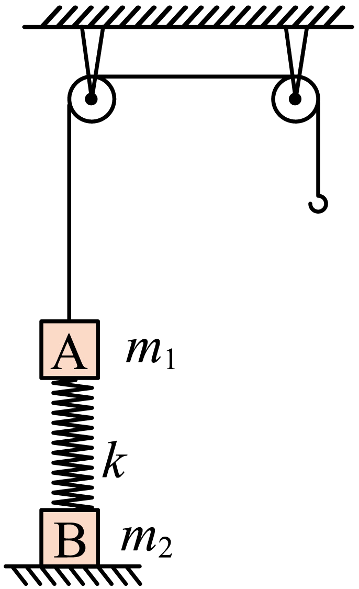

# Physics - 题目 975

**ID**: 70d885fde9ae462d877b6ca2dc7fd8aa
**年级**: Grade 12
**难度**: Medium-Hard
**题型**: Multiple-select

## 题目
如图，质量为 $m{{}_{1}}$ 的物体 ${\rm{A}}$ 经一轻质弹簧与下方地面上的质量为 $m{{}_{2}}$ 的物体 ${\rm{B}}$ 相连，弹簧的劲度系数为 $k$ ， ${\rm{A}}$ 、 ${\rm{B}}$ 都处于静止状态。​​​​​​​‌一条不可伸长的轻绳绕过轻滑轮，一端连物体 ${\rm{A}}$ ，另一端连一轻挂钩。开始时各段绳都处于伸直状态， ${\rm{A}}$ 上方的一段绳沿竖直方向。现在挂钩上挂一质量为 $m{{}_{3}}$ 的物体 ${\rm{C}}$ 并从静止状态释放，它恰好能使 ${\rm{B}}$ 离开地面但不继续上升，已知弹性势能的表达式是 $E{{}_{{\rm{p}}}}=$  $\frac {1}{2}kx{^{2}}$ ，重力加速度为 $g$ ，不计空气阻力，下列说法正确的是（      ）

## 解答

1. 刚开始，A的重力与弹簧弹力已经抵消，无需满足 $m{{}_{3}}$ 一定大于 $m{{}_{1}}{\rm ，A}$ 错误；初态弹簧被压缩 $x{{}_{1}}$ ，分析A物体受力有 $m{{}_{1}}g-kx{{}_{1}}=0$ ，得 $x{{}_{1}}=\frac {m{{}_{1}}g}{k}$ ，末态B离开地面时弹簧伸长 $x{{}_{2}}$ ，分析B物体受力有 $m{{}_{2}}g-kx{{}_{2}}=0$ ，得 $x{{}_{2}}=\frac {m{{}_{2}}g}{k}$ ，可知A物体上升的高度是 $h=x{{}_{1}}+x{{}_{2}}$ ，对 ${\rm{A}}、{\rm{B}}、{\rm{C}}$ 和弹簧构成的系统，由机械能守恒定律有 $-\left ({m{{}_{3}}-m{{}_{1}}}\right )gh=-\left ({\frac {1}{2}kx{{}_{2}^{2}}-\frac {1}{2}kx{{}_{1}^{2}}}\right )$ ，若 $m{{}_{3}}$ 大于 $m{{}_{1}}$ ，则 $x{{}_{2}}$ 也大于 $x{{}_{1}}$ ， $m{{}_{2}}$ 也大于 $m{{}_{1}}$ ， ${\rm{B}}$ 正确； ${\rm{B}}$ 物体离地的瞬间，A、C减速且加速度大小相等，由牛顿第二定律对C有 $F{{}_{拉}^{{\rm{^{′}}}}}-m{{}_{3}}g=m{{}_{3}}a$ ，对A有 $m{{}_{1}}g+F{{}_{弹}}-F{{}_{拉}^{{\rm{^{′}}}}}=m{{}_{1}}a$ ，其中 $F{{}_{弹}}{\rm{=}}m{{}_{2}}g$ ，解得 $a=\frac {m{{}_{2}}+m{{}_{1}}-m{{}_{3}}}{m{{}_{1}}+m{{}_{3}}}g{\rm ，C}$ 错误；若 $m{{}_{3}}=m{{}_{1}}$ ，当 ${\rm{A}}$ 加速度为0时速度最大，此时弹簧处于原长；对 ${\rm{A}}、{\rm{C}}$ 和弹簧组成的系统，由机械能守恒定律有 $0-\frac {1}{2}kx{{}_{1}^{2}}=-\left [\frac {1}{2}(m{{}_{1}}+m{{}_{3}})v{{}_{{\rm{A}}}^{{{2}}}}-0\right ]$ ，解得 $v{{}_{{\rm{A}}}}=g\sqrt {\frac {m{{}_{1}}}{2k}}{\rm ，D}$ 正确。

## 知识点

**中文**:
  - 弹簧问题中机械能守恒定律的应用

**English**:
  - Spring Problems

---
