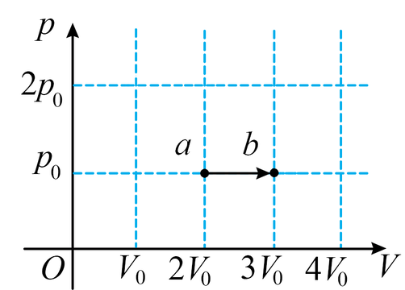

# Physics - 题目 172

**ID**: 7647de3f037547288e1b3f1910dbe18a
**年级**: Grade 12
**难度**: Medium-Hard
**题型**: Multiple-select

## 题目
爆震发动机作为一种极具潜力的新型动力装置，其工作原理涉及到复杂的热力学过程。​​​​​​​‌在某先进的爆震发动机实验平台中，对一定质量的理想气体进行模拟爆震燃烧实验。摩尔数为n的理想气体初始状态压强为 $p{{}_{0}}$ ，体积为 $2V{{}_{0}}$ ，对应下图中的a点。现在这部分气体经过等压膨胀，体积变为 $3V{{}_{0}}$ ，对应下图中的b点，气体在状态b经等温膨胀至状态c，压强变为 $0.5p{{}_{0}}$ 。又经等压压缩至状态d，最后等温压缩回到状态a。已知理想气体的体积V、压强P和温度T满足方程 $pV=nRT$ ；内能U满足关系 $U=\frac {5}{2}nRT$ 。其中R为常数，n为物质的量，根据以上信息可以判断（      ）

## 解答

1. 气体在状态点a时有 $p{{}_{0}}\cdot 2V{{}_{0}}=nRT{{}_{a}}$ ，解得气体在状态点a时温度为 $T{{}_{a}}=\frac {2p{{}_{0}}V{{}_{0}}}{nR}{\rm ，B}$ 正确；气体a从到b，发生等压变化，则有 $\frac {2V{{}_{0}}}{T{{}_{a}}}=\frac {3V{{}_{0}}}{T{{}_{b}}}$ ，解得气体在状态点b时温度为 $T{{}_{b}}=\frac {3p{{}_{0}}V{{}_{0}}}{nR}$ ，则气体在状态点b时的内能为 $U{{}_{b}}=\frac {5}{2}nRT{{}_{b}}=\frac {15p{{}_{0}}V{{}_{0}}}{2}{\rm ，A}$ 错误；气体在状态b经等温膨胀至状态c，则有 $T{{}_{c}}=T{{}_{b}}=\frac {3p{{}_{0}}V{{}_{0}}}{nR}$ ， $p{{}_{0}}\cdot 3V{{}_{0}}=0.5p{{}_{0}}V{{}_{c}}$ ，可得气体在状态点c时的体积为 $V{{}_{c}}=6V{{}_{0}}$ ，气体从状态c等压压缩至状态d，最后等温压缩回到状态a，可知状态d的温度为 $T{{}_{d}}=T{{}_{a}}=\frac {2p{{}_{0}}V{{}_{0}}}{nR}$ ，根据 $\frac {V{{}_{c}}}{T{{}_{c}}}=\frac {V{{}_{d}}}{T{{}_{d}}}$ ，解得气体在状态点d时的体积为 $V{{}_{d}}=4V{{}_{0}}$ ，从状态c等压压缩至状态d，外界对气体做功为 $W=0.5p{{}_{0}}\cdot (6V{{}_{0}}-4V{{}_{0}})=p{{}_{0}}V{{}_{0}}$ ，气体的内能变化量为 $ΔU=U{{}_{d}}-U{{}_{c}}=\frac {5}{2}nR(T{{}_{d}}-T{{}_{c}})=-\frac {5}{2}p{{}_{0}}V{{}_{0}}$ ，根据热力学第一定律可得 $ΔU=W+Q$ ，可得 $Q=-\frac {7}{2}p{{}_{0}}V{{}_{0}}$ ，知由c到d的过程气体从外界放热，C正确，D错误。

## 知识点

**中文**:
  - 气体的p-V图像问题

**English**:
  - p-V Graph Problems

---
