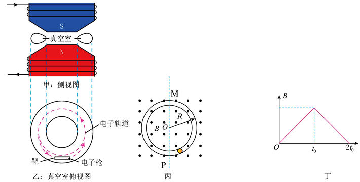

# Physics - 题目 1492

**ID**: 770448fd9c9c4fdd8846f9126a31183b
**年级**: Grade 12
**难度**: Medium-Hard
**题型**: Multiple-select

## 题目
图甲为人教版选择性必修2册P35页工业或医学上用到的电子感应加速器的核心部分侧视图；图乙为其真空室俯视图，当图甲中线圈通以变化的电流时，将在真空室所在空间产生变化的磁场，变化的磁场将产生涡旋电场，涡旋电场的方向与感应电流方向的判断方法完全相同。​​​​​​​‌如图丙所示为正在运动的电子，圆心为 $O$ 、半径为 $R$ 的光滑绝缘圆管道水平固定放置， $PM$ 为圆的一条直径，在 $P$ 点（电子枪口）静止释放一带电量为 $-e$ 、质量为 $m$ 的小球 $a$ ， $t=0$ 时刻开始，在垂直于圆管道平面的区域内加一随时间均匀变化的磁场，磁感应强度随时间的变化如图丁所示，小球 $a$ 开始运动后在 $t{{}_{0}}$ 时刻恰好到达 $M$ 点，恰好在 $2t{{}_{0}}$ 时刻回到 $P$ 点， $t{{}_{0}}$ 已知。下列选项正确的是（      ）

## 解答

1. 均匀变化的磁场产生恒定的涡旋电场，在0～t_{0}时间内小球沿切线方向速度大小均匀增大，沿切线方向可看作匀变速直线运动，位移大小为 $πR$ ，切向加速大小为 $a{{}_{1}}$ ，则有 $πR=\frac {1}{2}a{{}_{1}}t{{}_{0}}{^{2}}$
2. 解得 $a{{}_{1}}=\frac {2πR}{t{{}_{0}}{^{2}}}$
3. 小球还具有向心加速度，小球的加速度不等于 $\frac {2πR}{t{^{2}}}{\rm ，A}$ 错误；小球沿切线方向上有 $eE{{}_{感}}=ma{{}_{1}}$
4. 解得 $E{{}_{感}}=\frac {2πmR}{et{{}_{0}}{^{2}}}$
5. B正确；根据法拉第电磁感应定律得 $U=\frac {B}{t{{}_{0}}}S=E{{}_{感}}·2πR$
6. 又 $S=πR{^{2}}$
7. 解得 $B=\frac {4πm}{et{{}_{0}}}$
8. C错误；小球在 $t{{}_{0}}$ 时刻的速度最大，则受到的最大洛伦兹力为 $f=evB$ ， $v=a{{}_{1}}t{{}_{0}}$
9. 解的 $f=\frac {8Rmπ{^{2}}}{t{{}_{0}}{^{2}}}$
10. D正确。

## 知识点

**中文**:
  - 带电粒子的运动半径和周期公式及其简单应用

**English**:
  - Radius and Period Formulas and Applications

---
