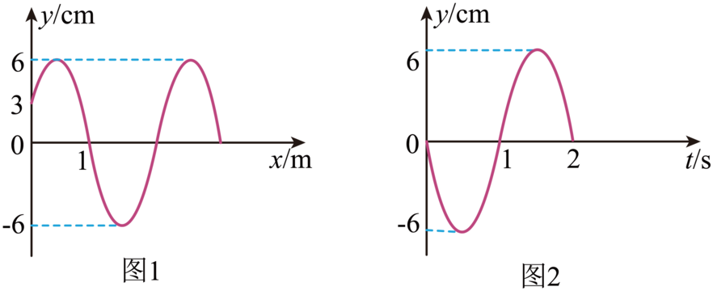

# Physics - 题目 1481

**ID**: 78d42085fb424c409651bc2f8374e279
**年级**: Grade 12
**难度**: Medium-Hard
**题型**: Multiple-select

## 题目
某简谐横波在 $t=1{\rm{s}}$ 时刻的波形图如图1所示，平衡位置在 $x=1{\rm{m}}$ 处的质点的振动图像如图2所示，其余数据图中已标出，下列说法正确的是（      ）​​​​​​​‌

## 解答

1. A．由振动图像图乙可知， $t=1{\rm{s}}$ 时刻平衡位置在 $x=1{\rm{m}}$ 处的质点振动方向沿 $y$ 轴正方向，结合图甲由微平移法可知该简谐波沿 $x$ 轴正方向传播，A错误；
2. B．设 $t=1{\rm{s}}$ 时刻的波形图对应的函数表达式为 $y=A\sin \left ({ωx+φ}\right )=A\sin \left ({\frac {2π}{λ}x+φ}\right )\left ({{\rm{c}}{\rm{m}}}\right )$
3. 由图甲可知， $A=6{\rm{c}}{\rm{m}}$
4. 当 $x{{}_{1}}=0$ 时， $y{{}_{1}}=3{\rm{c}}{\rm{m}}$
5. 代入得 $3=6\sin φ$
6. 解得 $φ=\frac {π}{6}$
7. 当 $x{{}_{2}}=1{\rm{m}}$ 时， $y{{}_{2}}=0$
8. 代入得 $0=6\sin \left ({\frac {2π}{λ}·1+\frac {π}{6}}\right )$
9. 解得 $λ=2.4{\rm{m}}$
10. 由图乙可知 $T=2{\rm{s}}$
11. 所以该波的波速为 $v=\frac {λ}{T}=\frac {2.4}{2}{\rm{m}}{\rm{/}}{\rm{s}}=1.2{\rm{m}}{\rm{/}}{\rm{s}}$
12. 故B正确；
13. C．设 $t=0$ 时刻开始 $x=0$ 处质点的振动方程为 $y=A\sin \left ({ωt+φ^{′}}\right )=6\sin \left ({\frac {2π}{T}t+φ^{′}}\right )=6\sin \left ({πt+φ^{′}}\right )\left ({{\rm{c}}{\rm{m}}}\right )$
14. 当 $t=1{\rm{s}}$ 时刻， $y{{}_{3}}=3{\rm{c}}{\rm{m}}$
15. 代入得 $6\sin \left ({π·1+φ^{′}}\right )=3$
16. 解得 $φ^{′}=-\frac {π}{6}$
17. 故 $t=0$ 时刻开始 $x=0$ 处质点的振动方程为 $y=6\sin \left ({πt-\frac {π}{6}}\right )\left ({{\rm{c}}{\rm{m}}}\right )$
18. 当 $t=\frac {7}{6}{\rm{s}}$ 时刻， $y{{}_{4}}=6\sin \left ({π·\frac {7}{6}-\frac {π}{6}}\right )=0$
19. 即 $t=\frac {7}{6}{\rm{s}}$ 时刻 $x=0$ 处质点位于平衡位置，C正确；
20. D．由图乙可知，从0时刻开始平衡位置在 $x=1{\rm{m}}$ 的质点的振动方程为 $y=-A\sin \left ({\frac {2π}{T}t}\right )=-6\sin \left ({πt}\right )\left ({{\rm{c}}{\rm{m}}}\right )$
21. 当 $t=\frac {13}{6}{\rm{s}}$ 时刻， $y{{}_{5}}=-6\sin \left ({π·\frac {13}{6}}\right )=-3{\rm{c}}{\rm{m}}$
22. 故平衡位置在 $x=1{\rm{m}}$ 的质点从0时刻开始经过 $\frac {13}{6}{\rm{s}}$ 走过的路程是 $s=4A+3{\rm{c}}{\rm{m}}=27{\rm{c}}{\rm{m}}$
23. 故D正确。CD。

## 知识点

**中文**:
  - 波的图像和振动图像的综合应用

**English**:
  - Integrated Application of Wave and Vibration Graphs

---
