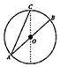

# Physics - 题目 1512

**ID**: 7b6593fd17ad4404b7e3de5fd7a3e09d
**年级**: Grade 12
**难度**: Medium-Hard
**题型**: Multiple-select

## 题目
如图所示，在一光滑绝缘水平面上有一个半径为R的圆，其中O为圆心，AB为直径，整个圆处于电场强度为E、方向与水平面平行的匀强电场中．在圆周上的A点有一个发射器，在水平面内沿不同的方向发射带电量为﹣q的小球，小球均会经过圆周上不同的点，在这些点中，经过C点的动能最大．小球之间的相互作用不计，且∠CAO＝30°，下列说法中正确的是（      ）​​​​​​​‌

## 解答

1. A.小球在匀强电场中，从A点运动到C点，根据动能定理qU_{AC}＝△E_{k}，因为到达C点时的小球的动能最大，所以U_{AC}最大，则在圆周上找不到与C电势相等的点．且由A到C电场力对小球做正功.
2. 过C点作切线，则CF为等势线．过C点作CF的垂线，则该线为电场线，场强方向如图示:
3. 
4. 故电场线沿CO方向;故A正确.
5. B.由图可知，A、B两点间的电势差
6. U_{AB}＝-E﹒2Rcos60°＝-ER;
7. 故B错误.
8. C.如果某小球从A点沿垂直于电场方向发射，恰好落到C点，小球只受电场力，做类平抛运动．垂直电场方向上：x＝Rsin60°＝v_{0}t，沿电场方向上：
9. ${\rm y=R{\cos}60{}^\circ =\frac {1}{2}\cdot \frac {qE}{m}t{^{2}}}$ ，
10. 由以上两式得：
11. ${\rm E{{}_{k0}}=\frac {1}{2}mv{{}_{0}^{2}}=\frac {3}{8}qER}$ ;
12. 故C错误.
13. D.如果某小球从A点沿垂直于电场方向发射，恰好落到B点，小球只受电场力，做类平抛运动.垂直电场方向上：
14. x＝2Rsin60°＝v_{0}t，
15. 沿电场方向上：
16. ${\rm y=R{\cos}60{}^\circ =\frac {1}{2}\cdot \frac {qE}{m}t{^{2}}}$ ，
17. 由以上两式得： ${\rm E{{}_{k0}}=\frac {1}{2}mv{{}_{0}^{2}}=\frac {3}{4}qER}$ ;故D正确.

## 知识点

**中文**:
  - 带电粒子（物体）在重力场和电场组成的复合场中的运动
  - 电势差与等势面的综合性问题

**English**:
  - Motion in Gravity and Electric Composite Fields
  - Comprehensive Problems on Potential Difference and Equipotential Surfaces

---
