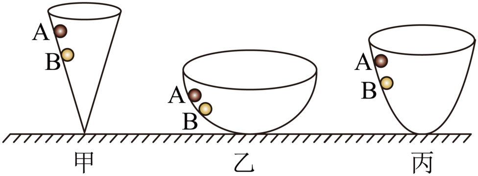

# Physics - 题目 1249

**ID**: 80fa63fe64d0457f98664c55c76900be
**年级**: Grade 12
**难度**: Medium-Hard
**题型**: Multiple-select

## 题目
如图所示，水平地面上固定着三个内壁光滑的容器甲、乙、丙，它们的中心轴线均和水平地面垂直．其中甲的内表面为圆锥面，乙的内表面为半球面，丙的内表面为旋转抛物面（将抛物线绕其对称轴旋转一周所得到的曲面），三个容器中均有两个小球贴着内壁在水平面内做匀速圆周运动，小球可视为质点．下列说法正确的是（      ）​​​​​​​‌

## 解答

1. A．设容器对小球弹力方向与竖直方向夹角为θ，对甲容器，由牛顿第二定律
2. $mg{\tan}θ=m\frac {v^{2}}{r}$
3. 可得
4. $v=\sqrt {gr{\tan}θ}$
5. 由于θ为定值，而A球半径更大，则A球线速度更大，A正确；
6. B．对乙容器，有
7. $mg{\tan}θ=mω^{2}R{\sin}θ$
8. 可得
9. $ω=\sqrt {\frac {g}{R{\cos}θ}}=\sqrt {\frac {g}{h}}$
10. 其中h为球心到圆周轨迹平面的距离，由于A球的圆周平面到球心更近，故A的角速度比B大，B正确；
11. CD．对丙容器，由
12. $mg{\tan}θ=mω^{2}x$
13. 有几何关系知，tanθ为抛物线上该点切线斜率，设抛物线方程为
14. $y{\rm{=}}kx^{2}$
15. 由平抛推论或数学求导均可得
16. ${\tan}θ=\frac {2y}{x}$
17. 得
18. $ω^{2}{\rm{=}}2kg$
19. 可知，角速度与位置无关，即两球角速度相等，C正确，D错误。
20. 故选ABC。

## 知识点

**中文**:
  - 倾斜面内的圆周运动问题

**English**:
  - Circular Motion on Inclined Planes

---
