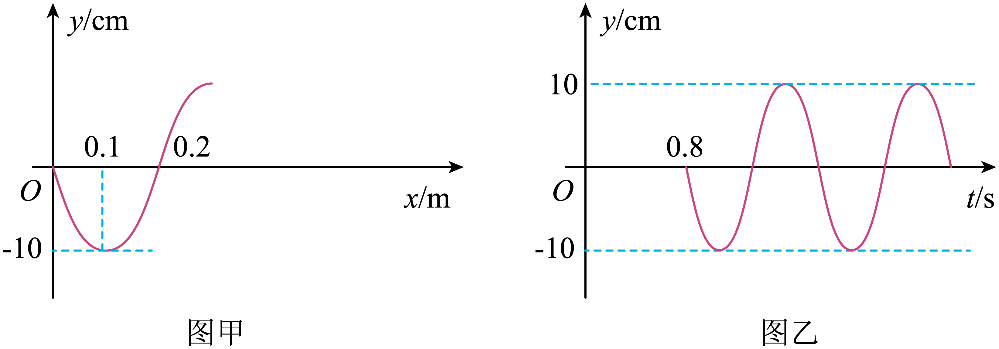

# Physics - 题目 391

**ID**: 847cf980082b4a25992894122a33c8af
**年级**: Grade 12
**难度**: Medium-Hard
**题型**: Multiple-select

## 题目
一列简谐横波沿x轴正方向传播，波源在坐标原点， $t{{}_{1}}=0.4{\rm{\;}}{\rm{s}}$ 时的部分波形图如图甲所示，图乙是这列波上x=1.0 m处质点从 $t{{}_{2}}=0.8{\rm{\;}}{\rm{s}}$ 时刻开始振动的图像。​​​​​​​‌下列说法正确的是（      ）

## 解答

1. 根据图甲可知波长 $λ=0.4{\rm{\;}}{\rm{m}}$ ，由于0.8 s时x=1.0 m处的质点才开始振动，根据图乙可知，其起振方向向下，即所有质点起振方向都是向下的，设在0.4 s之前，波源已经振动了Δt的时间，由于 $1.0{\rm{\;}}{\rm{m}}=\frac {5}{2}λ$ ，即波传播到x=1.0 m处所需要时间为 $\frac {5}{2}T$ ，由于所有质点起振方向都是向下的，根据图甲可知 $0.4{\rm{\;}}{\rm{s}}+{\rm{Δ}}t=\left ({n+\frac {1}{2}}\right )T$ ，根据图乙可得 $0.8{\rm{\;}}{\rm{s}}+{\rm{Δ}}t=\frac {5}{2}T$ ，解得 $0.4{\rm{\;}}{\rm{s}}=\left ({2-n}\right )T$ ，当n=0时，解得T=0.2 s，Δt=-0.3 s，不符合题意。当n=1时，解得T=0.4 s，Δt=0.2 s，结合图甲可知符合题意，则波速 $v=\frac {λ}{T}=1{\rm{\;}}{\rm{m}}{\rm{/}}{\rm{s}}{\rm ，AC}$ 正确，B错误；由于 $1.0{\rm{\;}}{\rm{m}}-0.6{\rm{\;}}{\rm{m}}=0.4{\rm{\;}}{\rm{m}}=λ$ ，可知波从x=0.6 m处传到x=1.0 m处所需时间为一个周期，则0~0.8 s时间内，x=0.6 m处的质点振动了一个周期，通过的路程为0.4 m，D正确；由以上分析可知，t=0时刻波传到x=0.2 m处，由于 $t=0.1{\rm{\;}}{\rm{s}}=\frac {T}{4}$ ，可知x=0.2 m处的质点处在波谷处，位移为-10 cm，E错误。

## 知识点

**中文**:
  - 波的图像和振动图像的综合应用

**English**:
  - Integrated Application of Wave and Vibration Graphs

---
