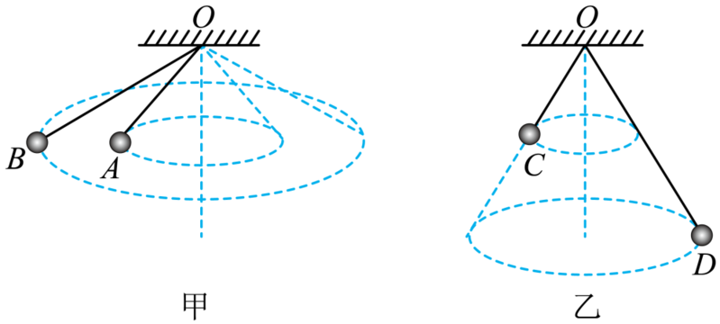

# Physics - 题目 67

**ID**: 87c5f5cdf60141ffb2ae9b4e32fa073c
**年级**: Grade 12
**难度**: Medium-Hard
**题型**: Multiple-select

## 题目
四个完全相同的小球A、B、C、D在水平面内均做圆锥摆运动。​​​​​​​‌如图甲所示，其中小球A、B在同一水平面内做圆锥摆运动（连接B球的绳较长）；如图乙所示，小球C、D在不同水平面内做圆锥摆运动，但是连接C、D的绳与竖直方向之间的夹角相同（连接D球的绳较长），则下列说法正确的是（      ）

## 解答

1. 对甲图AB分析：设细线与竖直方向的夹角为θ，小球的质量为m，小球AB到悬点O的竖直距离为h，则 $mg{\tan}θ=mω{^{2}}l\sin θ$  ，解得 $ω{\rm{=}}\sqrt {\frac {g}{l{\cos}θ}}=\sqrt {\frac {g}{h}}$ ，所以小球AB的角速度相同，线速度大小不相同，故A正确、B错误；对乙图CD分析：设细线与竖直方向的夹角为θ，小球的质量为m，绳长为L，绳上拉力为T，则有 $mg{\tan}θ=ma$ ， $T{\cos}θ=mg$ ，得 $a=g{\tan}θ$ ， $T=\frac {mg}{{\cos}θ}$ ，所以小球C、D向心加速度大小相同，小球CD受到绳的拉力大小也相同，故C正确、D错误。

## 知识点

**中文**:
  - 向心力的计算及应用
  - 圆锥摆问题

**English**:
  - Calculation and Application of Centripetal Force
  - Conical Pendulum Problems

---
