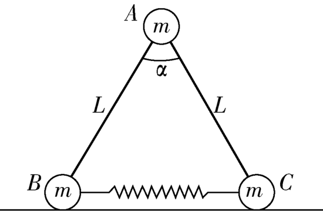

# Physics - 题目 1114

**ID**: 8bae48a01307452996c8203b06f547d2
**年级**: Grade 12
**难度**: Medium-Hard
**题型**: 多项选择题：本题共4小题，每小题4分，共计16分。每小题有多个选项符合题意。全部选对的得4分，选

## 题目
如图所示，三个小球A、B、C的质量均为m，A与B、C间通过铰链用轻杆连接，杆长为L。​​​​​​​‌B、C置于水平地面上，用一轻质弹簧连接，弹簧处于原长。现A由静止释放下降到最低点，两轻杆间夹角α由60°变为120°。A、B、C在同一竖直平面内运动，弹簧在弹性限度内，忽略一切摩擦，重力加速度为g。则此下降过程中（      ）

## 解答

1. A球动能最大时，速度最大，受合外力为零，对B、C整体的作用力为3mg，设B、C两球受地面向上的支持力为F_{N}，即F_{N}＝3mg，所以B受到的地面支持力等于 $\frac {3}{2}$mg，故B正确；A的动能达到最大之前，一直有向下的加速度，受到的合力方向向下，对B、C整体的作用力小于mg，B受到的地面支持力小于 $\frac {3}{2}$mg，故A正确；当A下降至最低点时，弹簧形变量最大，弹性势能最大，此时A的速度为零，加速度向上，故C错误；根据机械能守恒定律可知，弹簧的最大弹性势能等于A球下降至最低点时减少的重力势能，即E_{p}＝mg(Lcos30°－Lcos60°)＝ $\frac {\sqrt {3}-1}{2}$mgL，故D错误。

## 知识点

**中文**:
  - 弹簧问题中机械能守恒定律的应用

**English**:
  - Spring Problems

---
