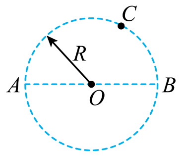

# Physics - 题目 2884

**ID**: 8c14f136307f40c683dc2d912c6e0573
**年级**: Grade 12
**难度**: Medium-Hard
**题型**: Multiple-select

## 题目
如图所示，空间中有一匀强电场区域（电场线未画出），圆心为O，半径为 $R=\sqrt {3}{\rm{m}}$ 的圆平行于电场方向，AB为过圆心的直径的两端点，C为圆弧上一点。​​​​​​​‌已知A点电势为−5V，B点电势为7V，C点电势为1V，BC连线长度也为 $\sqrt {3}{\rm{m}}$ 。电子从A点垂直电场线方向以不同大小的初速度射入电场。下列说法正确的是（      ）

## 解答

1. 由于 $U{{}_{BO}}=φ{{}_{{{}_{B}}}}-φ{{}_{O}}=U{{}_{OA}}=φ{{}_{O}}-φ{{}_{A}}$ ，解得 $φ{{}_{O}}=1{\rm{V}}=φ{{}_{C}}$ ，可知，OC连线为等势线，由于电场线垂直于等势线且由高电势点指向低电势点，则匀强电场中的电场线方向垂直于OC连线，斜向左上方，A正确；结合上述可知，电场强度大小 $E=\frac {U{{}_{BO}}}{R\sin 60{^{\circ }}}=4{\rm{V}}{\rm{/}}{\rm{m}}{\rm ，B}$ 错误；电子从A点垂直电场线方向以不同大小的初速度射入电场做类平抛运动，结合上述可知，打到C点的电子有 $R\sin 60{}\degree =\frac {1}{2}at{{}_{1}^{2}}$ ， $R+R{\cos}60{}\degree =v{{}_{1}}t{{}_{1}}$ ，打到B点的电子有 $2R\sin 60{}\degree =\frac {1}{2}at{{}_{2}^{2}}$ ， $2R{\cos}60{}\degree =v{{}_{2}}t{{}_{2}}$ ，根据上述表达式可知，打到C点的电子沿电场方向的分位移小，经历时间短，而其垂直于电场方向的分位移大，即打到C点的电子的初速度大于打到B点的电子的初速度，C错误；电子做类平抛运动，电场垂直于OC连线，打到C点的电子与打到O点的电子在沿电场方向的分位移相等，结合上述可知，打到C点的电子与打到O点的电子的运动时间相等，D正确。

## 知识点

**中文**:
  - 匀强电场中电势差与电场强度的关系
  - 带电粒子在匀强电场中的运动

**English**:
  - U=Ed in Uniform Electric Field
  - Motion in Uniform Electric Field

---
