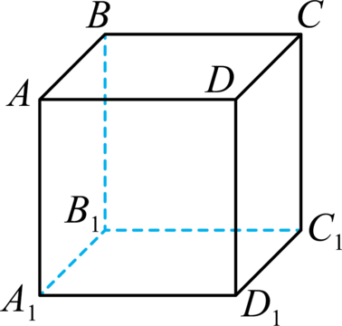

# Physics - 题目 1826

**ID**: 9b03db9c2b1a43d5b711486d00c5cce3
**年级**: Grade 12
**难度**: Medium-Hard
**题型**: Multiple-select

## 题目
如图所示，边长为 $L$ 的正方体 $ABCD-A{{}_{1}}B{{}_{1}}C{{}_{1}}D{{}_{1}}$ 处于匀强电场中。​​​​​​​‌一质量为 $m$ 、电荷量为 $q$ 的正电荷，在外力作用下由 $\mathrm{A}$ 点依次经过 $B$ 、 $B{{}_{1}}$ 、 $C{{}_{1}}$ 点。 $AB$ 段运动中电场力做正功 $W$ ， $BB{{}_{1}}$ 段运动中克服电场力做功 $W$ ， $B{{}_{1}}C{{}_{1}}$ 段运动中电场力做功为 $W$ ，取 $\mathrm{A}$ 点电势为0，则下列说法正确的是（      ）

## 解答

1. 题意可知沿 $AB、BB{{}_{1}}、B{{}_{1}}C{{}_{1}}$ 方向的场强分量分别为 $E{{}_{1}}=\frac {W}{Lq}、E{{}_{2}}=\frac {-W}{Lq}、E{{}_{3}}=\frac {W}{Lq}$ ，匀强电场的场强大小为 $E=\sqrt {E{{}_{1}^{2}}+E{{}_{2}^{2}}+E{{}_{3}^{2}}}=\frac {\sqrt {3}W}{Lq}{\rm ，A}$ 正确；因为 $BB{{}_{1}}$ 平行等于 $AA{{}_{1}}$ ，则有 $U{{}_{BB{{}_{1}}}}=U{{}_{AA{{}_{1}}}}=0-φ{{}_{A{{}_{1}}}}$ ，因为 $U{{}_{BB{{}_{1}}}}=\frac {-W}{q}$ ，联立解得 $φ{{}_{A{{}_{1}}}}=\frac {W}{q}{\rm ，B}$ 正确；题意可知在外力作用下q由 $\mathrm{A}$ 点依次经过 $B$ 、 $B{{}_{1}}$ 、 $C{{}_{1}}$ 点，电场力做的总功 $W{{}_{总{{1}}}}=W-W+W=W=E{{}_{{\rm{p}}A}}-E{{}_{{\rm{p}}C{{}_{1}}}}=0-qφ{{}_{C{{}_{1}}}}$ ，解得 $φ{{}_{C{{}_{1}}}}=\frac {-W}{q}$ ，电荷从A到B到 $B{{}_{1}}$ ，电场力做功 $W{{}_{总{{2}}}}=W-W=E{{}_{{\rm{p}}A}}-E{{}_{{\rm{p}}B{{}_{1}}}}=0-qφ{{}_{B{{}_{1}}}}$ ，解得 $φ{{}_{B{{}_{1}}}}=0$ ，因为 $AB{{}_{1}}$ 平行等于 $DC{{}_{1}}$ ，则有 $U{{}_{AB{{}_{1}}}}=U{{}_{DC{{}_{1}}}}=φ{{}_{D}}-φ{{}_{C{{}_{1}}}}$ ，联立解得 $φ{{}_{D}}=\frac {-W}{q}$ ，则将该电荷移到 $CDD{{}_{1}}C{{}_{1}}$ 中心，其电势能为 $E{{}_{{\rm{p}}中心}}=qφ{{}_{中心}}=q\times \frac {φ{{}_{D}}+φ{{}_{C{{}_{1}}}}}{2}=-W{\rm ，C}$ 正确；由于q为正电荷，结合做功情况易知 $E{{}_{1}}$ 方向A指向B、 $E{{}_{2}}$ 方向 $B{{}_{1}}$ 指向B(或 $A{{}_{1}}$ 指向A)、 $E{{}_{3}}$ 方向 $B{{}_{1}}$ 指向 $C{{}_{1}}$ (或 $\mathrm{A}$ 指向D)，由于三个分矢量大小相等，由场强叠加原则可知匀强电场的方向从 $A{{}_{1}}$ 指向C，D错误。

## 知识点

**中文**:
  - 匀强电场中电势差与电场强度的关系

**English**:
  - U=Ed in Uniform Electric Field

---
