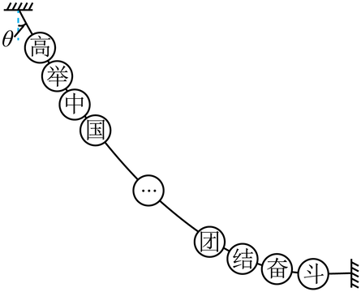

# Physics - 题目 1607

**ID**: 9be75b6134e947799e4b1fade06b265c
**年级**: Grade 12
**难度**: Medium-Hard
**题型**: Multiple-select

## 题目
为庆祝党的二十大的胜利召开，腾冲热海景区挂出32个灯笼（相邻两个灯笼间由轻绳连接），依次贴上“高举中国特色社会主义旗帜，为全面建设社会主义现代化国家而团结奋斗”，从高到低依次标为1、2、3、…、32。​​​​​​​‌在无风状态下，32个灯笼处于静止状态，简化图如图所示，与灯笼“斗”右侧相连的轻绳处于水平状态，已知每一个灯笼的质量 $m=0.5{\rm{k}}{\rm{g}}$ ，重力加速度 $g=10{\rm{m}}{\rm{/}}{\rm{s}}{^{2}}$ ，悬挂灯笼的轻绳最大承受力 $T{{}_{{\rm{m}}}}=320{\rm{N}}$ ，最左端连接的轻绳与竖直方向的夹角为 $θ$ 。下列说法正确的是（      ）

## 解答

1. 当最左端连接的轻绳的拉力大小为 $T{{}_{{\rm{m}}}}=320{\rm{N}}$ 时，θ最大，此时灯笼整体受力如图所示
2. 
3. 由平衡条件水平方向有 $T{{}_{{\rm{m}}}}\sin θ{{}_{{\rm{m}}}}=F{{}_{2}}$ ，竖直方向有 $T{{}_{{\rm{m}}}}\cos θ{{}_{{\rm{m}}}}=32mg$ ，联立解得 $θ{{}_{{\rm{m}}}}=60{}\degree ，F{{}_{2}}=160\sqrt {3}{\rm{N}}{\rm ，A}$ 错误，B正确；当 $θ=37{}\degree $ 时，此时灯笼整体受力如图所示
4. 
5. 由平衡条件知，最右端轻绳的拉力 $F{{}_{21}}=32mg{\tan}θ$ ，对第9个灯笼至第32个灯笼整体，其受力情况跟灯笼整体的受力情况相同，由平衡条件 ${\tan}α=\frac {F{{}_{21}}}{\left ({32-8}\right )mg}=1$ ，则第8个灯笼与第9个灯笼间轻绳与竖直方向的夹角 $α=45{}\degree {\rm ，C}$ 正确；当 $θ=53{}\degree $ 时，此时灯笼整体受力如图所示
6. 
7. 由平衡条件知，最右端轻绳的拉力 $F{{}_{22}}=32mg{\tan}θ$ ，对第9个灯笼至第32个灯笼整体，其受力情况跟灯笼整体的受力情况相同，由平衡条件 ${\tan}β=\frac {F{{}_{22}}}{\left ({32-8}\right )mg}=\frac {16}{9}$ ，则第8个灯笼与第9个灯笼间轻绳与竖直方向的夹角 $β\ne 45{}\degree {\rm ，D}$ 错误。

## 知识点

**中文**:
  - 在共点力平衡中整体法与隔离法的应用
  - 正交分解法与三角形定则在平衡问题中的应用

**English**:
  - Whole and Isolation Methods in Equilibrium
  - Orthogonal Decomposition and Triangle Rule in Equilibrium

---
