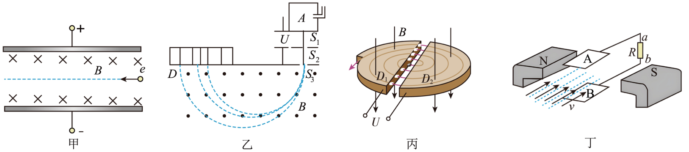

# Physics - 题目 1482

**ID**: 9dcc709f81e54e76aed45beb51a95165
**年级**: Grade 12
**难度**: Medium-Hard
**题型**: Multiple-select

## 题目
电磁场与现代高科技密切关联，并有重要应用。​​​​​​​‌如图所示，带电粒子（不计重力）在以下四种器件中运动的说法正确的是（      ）

## 解答

1. 图甲是速度选择器的结构示意图，速度 $v=\frac {E}{B}$ 的带电粒子能够沿直线从左侧进入，因洛伦兹力与电场力等大反向，则能匀速通过速度选择器，若从右侧进入时洛伦兹力和电场力方向相同，则粒子不能匀速通过选择器，A错误；图乙是质谱仪的结构示意图，粒子先通过电场加速，则 $Uq=\frac {1}{2}mv{^{2}}$ ，然后在磁场中偏转，则 $qvB=m\frac {v{^{2}}}{R}$ ，解得 $R=\frac {1}{B}\sqrt {\frac {2Um}{q}}$ ，粒子打在底片上的位置越靠近狭缝S，则R越小，说明粒子的比荷越大，B正确；图丙是用来加速带电粒子的回旋加速器的示意图，粒子动能最大时满足 $qvB=m\frac {v{^{2}}}{R}$ ，则最大动能 $E{{}_{km}}=\frac {1}{2}mv{^{2}}=\frac {q{^{2}}B{^{2}}R{^{2}}}{2m}$ ，可知要想粒子获得的最大动能增大，可增大D形盒半径R，C正确；图丁为是磁流体发电机的结构示意图，将一束等离子体喷入磁场，根据左手定则可知，正离子偏向B极板，则A、B两板间会产生电压，且B板电势高，D错误。

## 知识点

**中文**:
  - 回旋加速器
  - 质谱仪
  - 速度选择器
  - 磁流体发电机

**English**:
  - Cyclotron
  - Mass Spectrometer
  - Velocity Selector
  - MHD Generator

---
