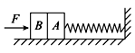

# Physics - 题目 2141

**ID**: a50ca25f786446b3b75e6f1e746b576d
**年级**: Grade 12
**难度**: Medium-Hard
**题型**: Multiple-select

## 题目
如图所示，劲度系数为k的轻弹簧的一端固定在墙上，另一端与置于水平面上质量为m的物体A连接（另有一个完全相同的物体B紧贴着A，不粘连），弹簧水平且无形变。​​​​​​​‌用水平力F缓慢推动物体B，在弹性限度内弹簧长度被压缩了x_{0}，此时物体A、B静止。撤去F后，物体A、B开始向左运动，已知重力加速度为g，物体A、B与水平面间的动摩擦因数为μ。则（      ）

## 解答

1. A．撤去F瞬间，对A、B系统，由牛顿第二定律得
2. $kx{{}_{0}}-2{\rm μm}g=2ma$
3. 解得
4. $a=\frac {kx{{}_{0}}}{2m}-μg$
5. 所以A正确；
6. B．撤去F后，A、B系统在水平向左做加速运动，因为弹簧形变量减小，系统所受合外力变小，所以系统得加速度减小，所以物体A和B先向左做加速度减小的加速运动；弹簧弹力小于摩擦力时，物体A和B做加速度增大的减速运动；当物体A和B与弹簧分离后，在摩擦力的作用下，做匀减速运动，所以B错误；
7. C．由于物体A、B先向左做加速度减小的加速运动，所以当加速度为零时，即合力为零时，速度达到最大，设此时的形变量为x，则
8. $kx=2{\rm μm}g$
9. 解得
10. $x=\frac {2{\rm μm}g}{k}$
11. 则物体A、B的运动距离
12. $s=x{{}_{0}}-x=x{{}_{0}}-\frac {2{\rm μm}g}{k}$
13. 所以C正确；
14. D．物体A、B向左运动要分离时，对B有
15. ${\rm μm}g=ma$
16. 对A有
17. ${\rm μm}g-kx=ma$
18. 解得
19. x=0
20. 所以若物体A、B向左运动要分离，弹簧处于原长状态，物体A、B运动的距离为 $x{{}_{0}}$ ，所以D错误。
21. 故选AC。

## 知识点

**中文**:
  - 牛顿第二定律求解瞬时突变问题
  - 运动过程分析、多过程问题
  - 连接体问题（整体和隔离法）、临界问题

**English**:
  - Solving Instantaneous Change Problems with Newton's 2nd Law
  - Analysis of Motion Process and Multi-process Problems
  - Connected Bodies Problems (Whole/Isolation Method), Critical Problems

---
