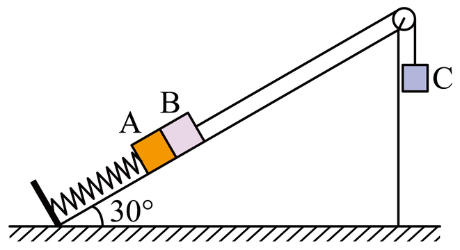

# Physics - 题目 2160

**ID**: a58d6d7413cc4b7081a1464e6d29e394
**年级**: Grade 12
**难度**: Medium-Hard
**题型**: Multiple-select

## 题目
如图所示，倾角为 $30{}\degree $ 足够长的固定光滑斜面底端有一固定挡板，轻弹簧一端与挡板连接，另一端与物块A接触但不连接，A上方放置另一物块B，B与物块C用跨过光滑轻质定滑轮的细线连接。​​​​​​​‌开始时用手托住C，使细线处于伸直但不拉紧的状态，此时A、B静止在斛面上。某时刻突然释放C，一段时间后A、B分离，此时C未触地。已知A、B分离时，B的速度大小为v，A、B、C的质量均为m，弹簧劲度系数为k，弹簧的形变始终在弹性限度内，重力加速度为g。下列说法正确的是（ $\quad $ ）

## 解答

1. A．未释放C时，弹簧的弹力为F,以AB为研究对象，则有 $F=2mg\sin 30{}\degree =mg$ ，刚释放C时，设AB间的弹力为 $F{^{^{′}}}$ ，绳子的拉力为T，此时的加速度为a，对C而言 $mg-T=ma$ ，对于B而言，则有 $T+F{^{^{′}}}-mg\sin 30{}\degree =ma$ ，以A为研究对象，根据牛顿第二定律 $F-F{^{^{′}}}-mg\sin 30{}\degree =ma$ ，联立解得 $a=\frac {1}{3}g$ ， $F{^{^{′}}}=\frac {1}{6}mg{\rm ，A}$ 错误；
2. B．AB分离时，其间的弹力为零，设此时的加速度为 $a{^{^{′}}}$ ，绳子的拉力为 $T{^{^{′}}}$ ，以C为研究对象则有 $mg-T{^{^{′}}}=ma{^{^{′}}}$ ，以B为研究对象，根据牛顿第二定律可知 $T{^{^{′}}}-mg\sin 30{}\degree =ma{^{^{′}}}$ ，解得 $a{^{^{′}}}=\frac {1}{4}g{\rm ，B}$ 正确；
3. C．初始时弹簧的压缩量 $x=\frac {F}{k}=\frac {mg}{k}$ ，当A的速度最大时，弹簧弹力与A重力的下滑分力平衡，则有 $x{^{^{′}}}=\frac {mg\sin 30{}\degree }{k}=\frac {mg}{2k}{\rm ，A}$ 速度最大时沿斜面上升的距离 $Δx=x-x{^{^{′}}}=\frac {mg}{2k}{\rm ，C}$ 错误；
4. D．AB分离瞬间，它们具有共同沿斜面向上的加速度，合外力沿斜面向上，弹簧仍处于压缩状态，D正确。选BD。

## 知识点

**中文**:
  - 弹簧问题中机械能守恒定律的应用

**English**:
  - Spring Problems

---
