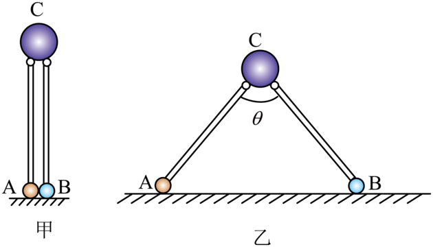

# Physics - 题目 1915

**ID**: ab08cfb48d104e74820b3af6a7fb0250
**年级**: Grade 12
**难度**: Medium-Hard
**题型**: Multiple-select

## 题目
三个小球（均可视为质点） ${\rm{A}}、{\rm{B}}、{\rm{C}}$ 质量分别为 $3m、2m、m$ ，通过两根长度均为 $l$ 的轻杆和轻质光滑铰链连接。​​​​​​​‌初始时整个装置通过外力作用静止于竖直平面内，且两杆呈竖直状态，如图甲所示。 ${\rm{A}}、{\rm{B}}$ 位于光滑水平地面上，某时刻撤去外力，系统在重力作用下开始运动，某时刻两杆之间的夹角为 $θ$ ，如图乙所示。下列说法正确的是（      ）

## 解答

1. 系统水平方向动量守恒，从静止释放到 $C$ 球刚要与地面接触的瞬间，水平方向速度均为0，所以 $\mathrm{A}$ 经历了先加速后减速的过程，A正确；根据机械能守恒 $mgl=\frac {1}{2}mv{^{2}}$ ，解得 $v=\sqrt {2gl}{\rm ，B}$ 正确；由三者的质量关系以及水平方向动量守恒可判断，A向左运动 ${\rm B}$ 和 ${\rm C}$ 向右运动。设三者的位移大小分别为 $x{{}_{{\rm{A}}}}、x{{}_{{\rm{B}}}}、x{{}_{{\rm{C}}}}$ ，由动量守恒定律可得 $2mgx{{}_{{\rm{A}}}}=2mgx{{}_{{\rm{B}}}}+mgx{{}_{{\rm{C}}}}$ ，且 $x{{}_{{\rm{A}}}}+x{{}_{{\rm{C}}}}=l，x{{}_{{\rm{B}}}}-x{{}_{{\rm{C}}}}=l$ ，解得 $x{{}_{{\rm{A}}}}=\frac {5l}{6}，x{{}_{{\rm{B}}}}=\frac {7l}{6}，x{{}_{{\rm{C}}}}=$  $\frac {l}{6}{\rm ，C}$ 错误；由三者的质量关系以及水平方向动量守恒可判断， ${\rm A}$ 向左运动， ${\rm B}$ 和 ${\rm C}$ 向右运动。当 $θ$ 等于 $\frac {π}{2}$ 时，设三者的速度大小分别为 $v{{}_{{\rm{A}}}}、v{{}_{{\rm{B}}}}、v{{}_{{\rm{C}}}}，v{{}_{{\rm{A}}}}$ 的方向水平向左， $v{{}_{{\rm{B}}}}$ 的方向水平向右， $v{{}_{{\rm{C}}}}$ 的方向斜向右下方，设 $v{{}_{{\rm{C}}}}$ 与 $BC$ 杆的夹角为 $α{\rm ，A}$ 与 ${\rm C}$ 球在沿 $AC$ 杆方向的分速度相同，即 $v{{}_{{\rm{A}}}}{\rm{c}}{\rm{o}}{\rm{s}}45{}\degree =v{{}_{{\rm{C}}}}{\rm{s}}{\rm{i}}{\rm{n}}α$ ， ${\rm B}$ 与 ${\rm C}$ 球在沿 $BC$ 杆方向的分速度相同，即 $v{{}_{{\rm{B}}}}{\rm{c}}{\rm{o}}{\rm{s}}45{}\degree =v{{}_{{\rm{C}}}}{\rm{s}}{\rm{i}}{\rm{n}}α$ ，又因为水平方向动量守恒，则有 $3mv{{}_{{\rm{A}}}}=2mv{{}_{{\rm{B}}}}+mv{{}_{{\rm{C}}}}{\rm{c}}{\rm{o}}{\rm{s}}\left ({α+45{^{\circ }}}\right )$ ，联立可得 $\frac {v{{}_{{\rm{A}}}}}{v{{}_{{\rm{B}}}}}=$  $\frac {5}{7}{\rm ，D}$ 正确。

## 知识点

**中文**:
  - 球杆模型圆周运动中机械能守恒定律的应用

**English**:
  - Rod-Ball Circular Motion Models

---
