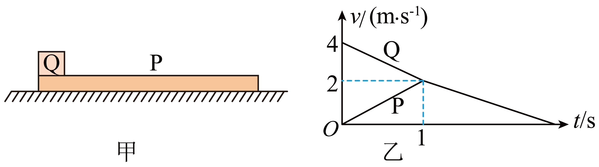

# Physics - 题目 2742

**ID**: af9479535ca54a63b48a5d9b4ec18ecb
**年级**: Grade 12
**难度**: Medium-Hard
**题型**: Multiple-select

## 题目
如图甲所示，一长木板P静止于水平地面上，t=0时小物块Q以4m/s的初速度从左端滑上长木板，二者的速度随时间的变化情况如图乙所示，运动过程中，小物块始终未离开长木板。​​​​​​​‌已知长木板P质量为1kg，小物块Q质量为3kg，重力加速度g取10m/s^{2}，在运动的全过程中（      ）

## 解答

1. 由图乙所示图像可知 $a{{}_{{\rm{Q}}}}=\frac {Δv{{}_{{\rm{Q}}}}}{Δt{{}_{{\rm{Q}}}}}=-2{\rm{m}}{\rm{/}}{\rm{s}}{^{{{2}}}}$ ，对Q由牛顿第二定律得 $-μ{{}_{1}}m{{}_{{\rm{Q}}}}g=m{{}_{{\rm{Q}}}}a{{}_{{\rm{Q}}}}$ ，代入数据解得小物块与长木板间的动摩擦因数 $μ{{}_{1}}=0.2{\rm ，A}$ 正确；由图乙所示图像可知，P、Q相对运动时P的加速度为 $a{{}_{{\rm{P}}}}=\frac {Δv{{}_{{\rm{P}}}}}{Δt{{}_{{\rm{P}}}}}=2{\rm{m}}{\rm{/}}{\rm{s}}{^{{{2}}}}$ ，对P由牛顿第二定律得 $μ{{}_{1}}m{{}_{{\rm{Q}}}}g-μ{{}_{2}}(m{{}_{{\rm{P}}}}+m{{}_{{\rm{Q}}}})g=m{{}_{{\rm{P}}}}a{{}_{{\rm{P}}}}$ ，代入数据解得长木板与地面间的动摩擦因数 $μ{{}_{2}}=0.1{\rm ，B}$ 错误；小物块相对于长木板的位移 $x=v{{}_{0}}t+\frac {1}{2}a{{}_{{\rm{Q}}}}t{^{2}}-\frac {1}{2}a{{}_{{\rm{P}}}}t{^{2}}$ ，其中 $v{{}_{0}}=4{\rm{m}}{\rm{/}}{\rm{s}}$ ， $t=1{\rm{s}}$ ，代入数据解得 $x=2{\rm{m}}$ ，小物块与长木板间因摩擦产生的热量 $Q=μ{{}_{1}}m{{}_{{\rm{Q}}}}gx$ ，代入数据解得 $Q=12{\rm{J}}{\rm ，C}$ 错误；小物块与长木板相对滑动过程，长木板的位移 $x{{}_{板}}=\frac {1}{2}a{{}_{{\rm{P}}}}t{^{2}}=1{\rm{m}}$ ，对长木板由动能定理得 $W-μ{{}_{2}}(m{{}_{{\rm{P}}}}+m{{}_{{\rm{Q}}}})gx{{}_{板}}=\frac {1}{2}m{{}_{{\rm{P}}}}v{^{2}}$ ，其中 $v=2{\rm{m}}{\rm{/}}{\rm{s}}$ ，代入数据解得此过程小物块对长木板做的功 $W=6{\rm{J}}{\rm ，}$ ，滑块与长木板共速到静止过程滑行的距离 $x=\frac {v{^{2}}}{2μ{{}_{2}}g}=2{\rm{m}}$ ，减速过程由动能定理得 $W^{′}-μ{{}_{2}}(m{{}_{{\rm{P}}}}+m{{}_{{\rm{Q}}}})gx=0-\frac {1}{2}m{{}_{{\rm{P}}}}v{^{2}}$ ，代入数据解得 $W^{′}=6{\rm{J}}$ ，小物块对长木板做的功 $W{{}_{总}}=W+W^{′}=12{\rm{J}}{\rm ，D}$ 正确。

## 知识点

**中文**:
  - 板块模型中的能量守恒问题

**English**:
  - Energy Conservation in Plate Models

---
