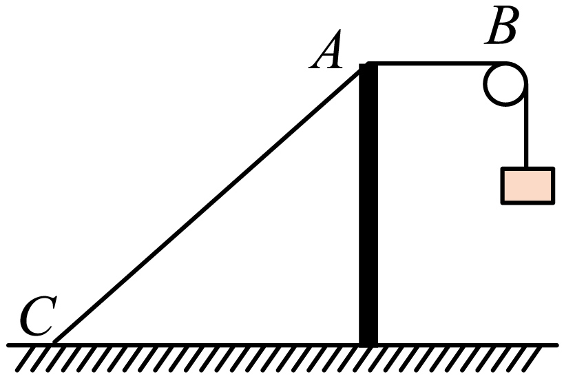

# Physics - 题目 353

**ID**: b3ecb2155c00496b91a3d6aa99dd5d15
**年级**: Grade 12
**难度**: Medium-Hard
**题型**: Multiple-select

## 题目
如图所示，在水平面上竖直放置着一根直杆，杆上A点分别系着不可伸长的轻绳 $AB$ 和 $AC$ ，轻绳 $AB$ 水平跨过一个光滑定滑轮，在另一端系着一个重物，轻绳 $AC$ 固定在地面，直杆处于平衡状态。​​​​​​​‌若缩短 $AC$ 的长度，使C点右移，杆仍保持平衡。关于 $AC$ 的拉力T和地面对杆的支持力N，下列说法正确的是（      ）

## 解答

1. 
2. 设轻绳AC的拉力为 $F{{}_{C}}$ ，与竖直杆的夹角为 $α$ ，轻绳AB的拉力为 $F{{}_{B}}$ ，直杆在A点的支持力为 $F{{}_{A}}$ ，由于直杆处于平衡状态，则A处三力平衡，有
3. $F{{}_{C}}=\frac {F{{}_{B}}}{{\sin}α}$ ， $F{{}_{A}}{\rm{=}}F{{}_{B}}{\cot}α$
4. 缩短 $AC$ 的长度，使C点右移，夹角 $α$ 减小， $F{{}_{B}}$ 还是等于重物的重力，方向也不变，杆仍保持平衡，还是三力平衡，满足上面的关系，则 $F{{}_{C}}$ 和 $F{{}_{A}}$ 均增大。所以T增大。根据牛顿第三定律可知，两根绳子对直杆的压力就增大，所以地面对杆的支持力N增大，BD正确。

## 知识点

**中文**:
  - 受力分析
  - 解析法在解动态平衡问题中的应用
  - 相似三角形法在动态平衡问题中的应用
  - 图解法在动态平衡问题中的应用

**English**:
  - Force Analysis
  - Analytical Method for Dynamic Equilibrium
  - Similar Triangles Method for Dynamic Equilibrium
  - Graphical Method for Dynamic Equilibrium

---
