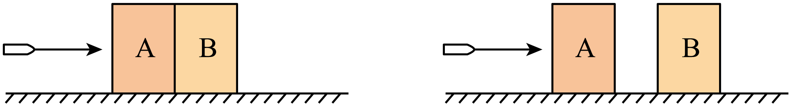

# Physics - 题目 913

**ID**: b5a6b3ddf78a42e197fc3da83788c063
**年级**: Grade 12
**难度**: Medium-Hard
**题型**: Multiple-select

## 题目
为了研究多层钢板在不同模式下的防弹效果，建立如下简化模型。​​​​​​​‌如图所示，两完全相同的钢板A、B厚度均为d，质量均为m。第一次把A、B焊接在一起静置在光滑水平面上，质量也为m的子弹水平射向钢板A，恰好将两钢板击穿。第二次把A、B间隔一段距离水平放置，子弹以同样的速度水平射向A，穿出后再射向B，且两块钢板不会发生碰撞。设子弹在钢板中受到的阻力为恒力，不计子弹的重力，子弹可视为质点。下列说法正确的是（      ）

## 解答

1. 第一次子弹相对A、B做匀减速直线运动，恰好击穿时末速度为0，根据逆向思维，可以将看成子弹相对A、B做初速度为0的反向匀加速直线运动，穿过B、A的相对位移相等，则时间之比为 $1:(\sqrt {2}-1)$ ，所以穿过A、B所用时间之比为 $(\sqrt {2}-1):1{\rm ，A}$ 错误；设子弹的初速度为v_{0}，受到的阻力大小为f，第一次穿过A、B时共同速度为v，对系统，由动量守恒有 $mv{{}_{0}}=(m+2m)v$ ，由能量守恒有 $f\cdot 2d=\frac {1}{2}mv{{}_{0}^{2}}-\frac {1}{2}\left ({m+2m}\right )v{^{2}}$ ，可得 $fd=\frac {1}{6}mv{{}_{0}^{2}}$ ，第二次子弹穿过A时，设子弹速度为v_{1}，A的速度为u，假设不能穿透B，最后与B的共同速度为v_{2}，进入B的深度为d′，对子弹和A，由动量守恒有 $mv{{}_{0}}=mv{{}_{1}}+mu$ ，由能量守恒有 $fd=\frac {1}{2}mv{{}_{0}^{2}}-\frac {1}{2}mv{{}_{1}^{2}}-\frac {1}{2}mu{^{2}}$ ，可得 $v{{}_{1}}=\frac {3+\sqrt {3}}{6}v{{}_{0}}$ ，对子弹和B，由动量守恒有 $mv{{}_{1}}=(m+m)v{{}_{2}}$ ，由能量守恒有 $f\cdot d^{′}=\frac {1}{2}mv{{}_{1}^{2}}-\frac {1}{2}(m+m)v{{}_{2}^{2}}$ ，可得 $d^{′}=\frac {2+\sqrt {3}}{4}d<d$ ，假设成立，B错误，C正确；第一次系统损失的机械能 $ΔE{{}_{1}}=f\cdot 2d$ ，第二次系统损失的机械能 ${\rm{Δ}}E{{}_{2}}=f\cdot (d+\frac {2+\sqrt {3}}{4}d)$ ，第一次、第二次系统损失的机械能之比为 ${\rm{Δ}}E{{}_{1}}:{\rm{Δ}}E{{}_{1}}=8:(6+\sqrt {3}){\rm ，D}$ 正确。

## 知识点

**中文**:
  - 子弹-木块模型

**English**:
  - Bullet-Block Model

---
