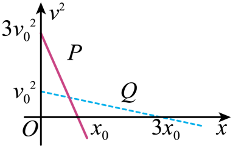

# Physics - 题目 90

**ID**: b8b98f56c89e408f8c28812ae0a56d95
**年级**: Grade 12
**难度**: Medium-Hard
**题型**: Multiple-select

## 题目
在星球A上将一小物块P竖直向上抛出，P的速度的二次方v2与位移x间的关系如图中实线所示；在另一星球B上用另一小物块Q完成同样的过程，Q的速度的二次方v2与位移x间的关系如图中虚线所示。​​​​​​​‌已知A的半径是B的半径的 $\frac {1}{2}$ ，若两星球均为质量均匀分布的球体（球的体积公式为 $V=\frac {4}{3}πr{^{3}}{\rm ，\mathit{r}}$ 为球的半径），两星球上均没有空气，不考虑两星球的自转，则（      ）

## 解答

1. A．设A、B星球表面重力加速度分别为 $g{{}_{{\rm{A}}}}、g{{}_{{\rm{B}}}}$ ，物体做竖直上抛运动初速度 $v{{}_{始}}$ ，根据速度与位移的关系式有
2. $v{^{2}}-v{{}_{始}^{2}}=-2gx$
3. 结合图像有
4. $2g{{}_{{\rm{A}}}}=\frac {3v{{}_{0}^{2}}}{x{{}_{0}}}$
5. $2g{{}_{{\rm{B}}}}=\frac {v{{}_{0}^{2}}}{3x{{}_{0}}}$
6. 解得
7. $\frac {g{{}_{{\rm{A}}}}}{g{{}_{{\rm{B}}}}}=\frac {9}{1}$
8. 故相同物体分别在A、B星球表面相同h高度下落，重力做功之比
9. $\frac {mg{{}_{{\rm{A}}}}h}{mg{{}_{{\rm{B}}}}h}=\frac {9}{1}$
10. 故A正确；
11. B．结合图像，根据以上分析可知，小物块P初速度为 $\sqrt {3}v{{}_{0}}$ ，设物P下落回原处的时间为 $t{{}_{{\rm{P}}}}$ ，由竖直上抛规律
12. $-\sqrt {3}v{{}_{0}}=\sqrt {3}v{{}_{0}}-g{{}_{{\rm{A}}}}t{{}_{{\rm{P}}}}$
13. 同理，小物块Q初速度为 $v{{}_{0}}$ ，设物Q上升到最高点的时间为 $t{{}_{{\rm{Q}}}}$ ，由竖直上抛规律
14. $0=v{{}_{0}}-g{{}_{{\rm{B}}}}t{{}_{{\rm{Q}}}}$
15. 解得
16. $\frac {t{{}_{{\rm{Q}}}}}{t{{}_{{\rm{P}}}}}=\frac {3\sqrt {3}}{2}$
17. 故B错误；
18. C．设星球A、B的密度分别为 $ρ{{}_{{\rm{A}}}}、ρ{{}_{{\rm{B}}}}$ ，在星球表面有
19. $G\frac {M{{}_{{\rm{A}}}}m}{R{{}_{{\rm{A}}}^{2}}}=mg{{}_{{\rm{A}}}}$
20. $G\frac {M{{}_{{\rm{B}}}}m}{R{{}_{{\rm{B}}}^{2}}}=mg{{}_{{\rm{B}}}}$
21. 星球密度
22. $ρ{{}_{{\rm{A}}}}=\frac {M{{}_{{\rm{A}}}}}{\frac {4}{3}πR{{}_{{\rm{A}}}^{3}}}$
23. $ρ{{}_{{\rm{B}}}}=\frac {M{{}_{{\rm{B}}}}}{\frac {4}{3}πR{{}_{{\rm{B}}}^{3}}}$
24. 联立解得
25. $\frac {ρ{{}_{{\rm{A}}}}}{ρ{{}_{{\rm{B}}}}}=18$
26. 故C错误；
27. D．第一宇宙速度等于星球表面卫星的环绕速度，则有
28. $G\frac {M{{}_{{\rm{A}}}}m}{R{{}_{{\rm{A}}}^{2}}}=m\frac {v{{}_{{\rm{A}}}^{2}}}{R{{}_{{\rm{A}}}}}$
29. $G\frac {M{{}_{{\rm{B}}}}m}{R{{}_{{\rm{B}}}^{2}}}=m\frac {v{{}_{{\rm{B}}}^{2}}}{R{{}_{{\rm{B}}}}}$
30. 解得
31. $\frac {v{{}_{{\rm{A}}}}}{v{{}_{{\rm{B}}}}}=\frac {3\sqrt {2}}{2}$
32. 故D正确。
33. 故选AD。

## 知识点

**中文**:
  - 天体密度的计算

**English**:
  - Calculation of Celestial Density

---
