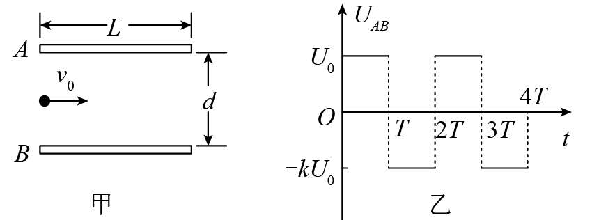

# Physics - 题目 559

**ID**: bb198911c9de4eaa80d0f94d91d8e78f
**年级**: Grade 12
**难度**: Medium-Hard
**题型**: Multiple-select

## 题目
真空中间距为d的两块平行金属板，板长为L，如图甲所示。​​​​​​​‌加在A、B间的电压U_{AB}做周期性变化，其正向电压为U_{0}，反向电压为-kU_{0}（k≥1），电压变化的周期为2T，如图乙所示。在t=0时刻，有一个质量为m、电荷量为e的电子，以初速度v_{0}垂直电场方向从两极板正中间射入电场，在运动过程中未与极板相撞，且不考虑重力的作用。则下列说法中正确的是（      ）

## 解答

1. AB．若k=1，电子在竖直方向的速度随时间变化的图象如图所示
2. 
3. 若电子恰好在2T时刻射出电场，竖直方向的速度为零，则电子射出时的速度为v_{0}；若电子恰好在3T时刻从A板边缘射出电场，根据动能定理可得
4. $ΔE{{}_{{\rm{k}}}}=e\times \frac {U{{}_{0}}}{2}\times \frac {1}{3}=\frac {eU{{}_{0}}}{6}$
5. 故A错误，B正确；
6. C．竖直方向，电子在0～T时间内做匀加速运动，加速度的大小
7. $a{{}_{1}}=\frac {eU{{}_{0}}}{md}$
8. 位移
9. $x{{}_{1}}=\frac {1}{2}a{{}_{1}}t{^{2}}$
10. 在T～2T时间内先做匀减速运动，后反向做匀加速运动，加速度的大小
11. $a{{}_{2}}=\frac {3eU{{}_{0}}}{2md}$
12. 初速度的大小
13. v_{1}=a_{1}T
14. 匀减速运动阶段的位移
15. $x{{}_{2}}=\frac {v{{}_{1}}{^{2}}}{2a{{}_{2}}}$
16. 由题知
17. $\frac {d}{2}\geqslant x{{}_{1}}+x{{}_{2}}$
18. 解得
19. $d\geqslant \sqrt {\frac {5eU{{}_{0}}T{^{2}}}{3m}}$
20. 故C正确；
21. D．若k=1.5且电子恰好在2T时刻射出电场，垂直电场方向速度为v_{0}，射出时竖直方向的速度大小为
22. $v{{}_{y}}=a{{}_{2}}T-a{{}_{1}}T=\frac {eU{{}_{0}}T}{2md}$
23. 合速度为
24. $v=\sqrt {v{{}_{0}}{^{2}}+{\left({\frac {eU{{}_{0}}T}{2md}}\right)^{2}}}$
25. 故D错误。
26. 故选BC。

## 知识点

**中文**:
  - 带电粒子在交变电场中的运动

**English**:
  - Motion in Alternating Electric Field

---
