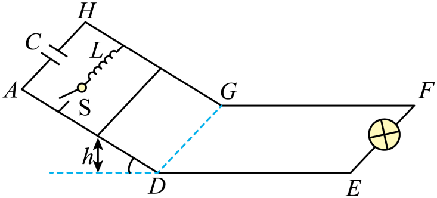

# Physics - 题目 2523

**ID**: c2eb851cd0774c389f1c72523c63ef65
**年级**: Grade 12
**难度**: Medium-Hard
**题型**: Multiple-select

## 题目
如图所示，间距均为d的倾斜金属导轨AD、HG与水平金属导轨DE、GF在D、G两点用绝缘材料平滑连接。​​​​​​​‌在ADGH平面内存在垂直于导轨平面向上、磁感应强度为 $B{{}_{1}}$ 的匀强磁场，在DEFG平面存在竖直向上、磁感应强度为 $B{{}_{2}}$ 的匀强磁场．在AD、HG间连接一电容为C的电容器和一个自感系数为L的电感线圈，在EF间接一小灯泡。开始时，开关S断开，一质量为m、长为d的金属棒在倾斜导轨上从距水平地面高为h的位置由静止释放，不计导轨和金属棒的电阻及一切摩擦，已知重力加速度为g，电容器的耐压值足够高．则下列说法正确的是（      ）

## 解答

1. A．金属棒在倾斜导轨上由静止释放，则金属棒做加速下滑，金属棒切割磁感线产生感应电动势为 $E=B{{}_{1}}dv$ ，由于对电容器充电，则电路中有电流产生，金属棒受到安培力作用，方向与金属棒运动方向相反。电容器所带的电荷量为 $Q=CU=CE=CB{{}_{1}}dv$ ，电容器充电电流为 $I=\frac {Q}{t}=\frac {CB{{}_{1}}dv}{t}=CB{{}_{1}}da$ ，设倾斜金属导轨平面与水平面夹角为θ，对金属棒由牛顿第二定律可得 $mg{\sin}θ-B{{}_{1}}Id=ma$ ，解得 $a=\frac {mg{\sin}θ}{m+CB{{}_{1}^{2}}d{^{2}}}$ ，由于m、θ、C、B_{1}、d都是定值，则加速度a是定值，可知金属棒在倾斜导轨上做匀加速运动，A正确；
2. B．金属棒在水平导轨上做切割磁感线运动产生感应电动势，产生感应电流，金属棒受到安培力作用，安培力与金属棒运动方向相反，安培力对金属棒产生加速度，使金属棒做减速运动，设小灯泡的电阻为R，则安培力为 $F{{}_{安}}=B{{}_{2}}I{{}_{1}}d=\frac {B{{}_{2}^{2}}d{^{2}}v}{R}$ ，可知小灯泡的电阻R随不随温度变化，则有 $\frac {v}{R}$ 都不是定值，则安培力是变力，因此金属棒做变加速运动，B错误；
3. C．金属棒进入DEFG区域后，闭合开关S后，电容器与电感线圈组成LC振荡电路，由LC振荡电路中的振荡电流特点，在闭合开关S瞬间，通过L的电流是零最小，C正确；
4. D．由速度位移关系公式可得，金属棒在进入DEFG区域时的速度大小为 $v{{}_{1}}=\sqrt {2ax}=\sqrt {2\times \frac {mg{\sin}θ}{m+CB{{}_{1}^{2}}d{^{2}}}\times \frac {h}{{\sin}θ}}=\sqrt {\frac {2mgh}{m+CB{{}_{1}^{2}}d{^{2}}}}$ ，金属棒在水平导轨上做减速运动，最后速度减到零，设通过小灯泡的平均电流为 $\bar I$ ，对金属棒由动量定理可得 $-B{{}_{2}}\bar Id\cdot Δt=0-mv{{}_{1}}$ ，又有 $q=\bar I\cdot Δt$ ，解得 $q=\frac {mv{{}_{1}}}{B{{}_{2}}d}=\frac {m}{B{{}_{2}}d}\sqrt {\frac {2mgh}{m+CB{{}_{1}^{2}}d{^{2}}}}$ ，D错误。选AC。

## 知识点

**中文**:
  - LC回路电磁振荡过程中各物理量的变化
  - 导体切割磁感线产生感应电动势（电流）的分析与计算
  - 动量定理及其应用

**English**:
  - Variations of Physical Quantities in LC Circuits
  - Analysis and Calculation of Cutting Magnetic Field Lines
  - Applications of Impulse-Momentum Theorem

---
