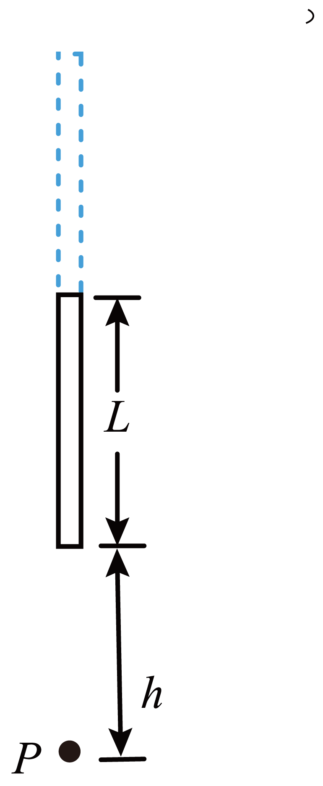

# Physics - 题目 2797

**ID**: c5c61f4031fb43588fb1095a8d00c9c9
**年级**: Grade 12
**难度**: Medium-Hard
**题型**: Multiple-select

## 题目
如图所示，某高楼的窗台上有一观察点P，距离地面足够高。​​​​​​​‌一长为L的木板在P点正上方h处竖直悬挂并由静止释放，木板通过P点的时间为 $t{{}_{1}}$ ，木板上端通过P点时的速度为 $v{{}_{1}}$ 。若木板长为2L，仍在P点正上方h处竖直悬挂并由静止释放，木板通过P点的时间为 $t{{}_{2}}$ ，木板上端通过P点时的速度为 $v{{}_{2}}$ 。下列说法正确的是（      ）

## 解答

1. A．若 $L=h$ ，则 $v{{}_{1}}{^{2}}=2g\left ({L+h}\right )=4gh$ ， $v{{}_{2}}{^{2}}=2g\left ({2L+h}\right )=6gh$ ，解得 $\frac {v{{}_{1}}}{v{{}_{2}}}=\frac {\sqrt {2}}{\sqrt {3}}{\rm ，A}$ 正确；
2. B．若 $L=2h$ ，则 $v{{}_{1}}{^{2}}=2g\left ({L+h}\right )=6gh$ ， $v{{}_{2}}{^{2}}=2g\left ({2L+h}\right )=10gh$ ，解得 $\frac {v{{}_{1}}}{v{{}_{2}}}=\frac {\sqrt {3}}{\sqrt {5}}{\rm ，B}$ 正确；
3. C．由自由落体运动公式 $h=\frac {1}{2}gt{^{2}}$ ，可得 $t=\sqrt {\frac {2h}{g}}$ 若 $L=h$ ，则 $t{{}_{1}}=\sqrt {\frac {2\left ({L+h}\right )}{g}}-\sqrt {\frac {2h}{g}}=\sqrt {\frac {2h}{g}}\left ({\sqrt {2}-1}\right )$ ， $t{{}_{2}}=\sqrt {\frac {2\left ({2L+h}\right )}{g}}-\sqrt {\frac {2h}{g}}=\sqrt {\frac {2h}{g}}\left ({\sqrt {3}-1}\right )$ ，则 $\frac {t{{}_{1}}}{t{{}_{2}}}=\frac {\sqrt {2}-1}{\sqrt {3}-1}{\rm ，C}$ 错误；
4. D．若 $L=2h$ ，则 $t{{}_{1}}=\sqrt {\frac {2\left ({L+h}\right )}{g}}-\sqrt {\frac {2h}{g}}=\sqrt {\frac {2h}{g}}\left ({\sqrt {3}-1}\right )$ ， $t{{}_{2}}=\sqrt {\frac {2\left ({2L+h}\right )}{g}}-\sqrt {\frac {2h}{g}}=\sqrt {\frac {2h}{g}}\left ({\sqrt {5}-1}\right )$ ，则 $\frac {t{{}_{1}}}{t{{}_{2}}}=\frac {\sqrt {3}-1}{\sqrt {5}-1}{\rm ，D}$ 正确。选ABD。

## 知识点

**中文**:
  - 自由落体运动规律的应用

**English**:
  - Applications of Free Fall Laws

---
