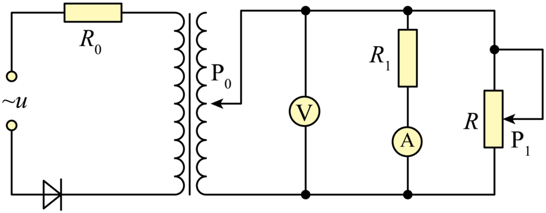

# Physics - 题目 2299

**ID**: cd1c809d09824e7d9edabd46322498ff
**年级**: Grade 12
**难度**: Medium-Hard
**题型**: Multiple-select

## 题目
如图，理想变压器原线圈与定值电阻 $R{{}_{0}}=8Ω$ 、理想二极管接在 $u=36{\sin}100πt\left ({{\rm{V}}}\right )$ 的交流电源上，理想变压器原、副线圈总匝数相同，滑动触头 $P{{}_{0}}$ 初始位置在副线圈正中间。​​​​​​​‌定值电阻 $R{{}_{1}}=6Ω$ ，滑动变阻器R的最大阻值为25Ω，滑片 $P{{}_{1}}$ 初始位置在 $R=3Ω$ 处。电流表、电压表均为理想交流电表，电源内阻不计，下列说法正确的是（      ）

## 解答

1. A．交变电流流过二极管后其电压有效值为18V，变压器变压比为2：1，变压器的副线圈并联电阻总阻值为 $R{{}_{并}}=\frac {R{{}_{1}}R}{R{{}_{1}}+R}=2\Omega $ ，等效在原线圈的等效电阻为，则原线圈的电流为 $I{{}_{1}}=\frac {U}{R{{}_{0}}+R^{′}}=\frac {9}{8}{\rm{A}}$ ，可知变压器原线圈的电压为 $U{{}_{1}}=I{{}_{1}}R^{′}=9{\rm{V}}$ ，则变压器输出端电压即电压表的示数为4.5V，电流表示数为 $I{{}_{{\rm{A}}}}=\frac {U{{}_{{\rm{V}}}}}{R{{}_{1}}}=\frac {4.5}{6}{\rm{A}}=0.75{\rm{A}}$ ，A正确；
2. B． 设 $\frac {n{{}_{1}}}{n{{}_{2}}}=k$ ，若保持P_{1}位置不变，P_{0}向下滑动时，n_{2}减小，则等效电阻 $R^{′}=k{^{2}}R{{}_{并}}$ 增大，原线圈电流变小，电压表示数为 $U{{}_{2}}=\frac {n{{}_{2}}}{n{{}_{1}}}U{{}_{1}}=\frac {n{{}_{2}}}{n{{}_{1}}}\cdot \frac {R^{′}}{R{{}_{0}}+R^{′}}U=\frac {18}{\frac {4}{k}+k}$ ，可知，当 $k=2$ 时U_{2}取得最大值，由于滑动触头P_{0}初始位置在副线圈正中间，即开始时 $k=2$ ，所以P_{0}向下滑动时，电压表示数一直变小，电流表示数也会一直变小，B错误；
3. C．当等效电阻 $R^{′}=R{{}_{0}}=8Ω$ 时， $k=2$ ，变压器的输出电压最大，则定值电阻 $R{{}_{1}}$ 的功率也最大， $R{{}_{1}}$ 上的功率最大约为 $P{{}_{1}}=\frac {U{{}_{2}^{2}}}{R{{}_{1}}}=\frac {(\frac {18}{4}){^{2}}}{6}{\rm{W}}=\frac {27}{8}{\rm{W}}\approx {{3}}{{.}}{{4}}{\rm{W}}$ ，C正确；
4. D．当等效电阻 $R^{′}=R{{}_{0}}=8Ω$ 时，变压器的输出功率最大，而此时对应的匝数比为 $k=2$ ， $R=3Ω$ ，理想变压器的输出功率有最大值约为 $P=\frac {U{{}_{1}^{2}}}{R^{′}}=10.125{\rm{W}}\approx {{1}}{{0}}{\rm{W}}$ ，D正确。选ACD。

## 知识点

**中文**:
  - 含有理想变压器的动态电路分析

**English**:
  - Dynamic Circuit Analysis with Ideal Transformers

---
