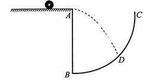

# Physics - 题目 774

**ID**: dbc910a32e5b4888b6af3cad7ce84f89
**年级**: Grade 12
**难度**: Medium-Hard
**题型**: 多项选择题

## 题目
如图所示，内壁光滑的四分之一圆弧轨道 $BC$ 竖直固定放置，轨道半径为 $R{{}_{0}}$ ，圆心为 $A$ 点， $AB、AC$ 分别是竖直半径和水平半径。​​​​​​​‌现让光滑水平面上的小球获得一个水平向右的速度 $v{{}_{0}}$ （未知量），小球从 $A$ 点离开后运动到圆弧上的 $D$ 点，重力加速度为 $g$ ，小球可视为质点，下列说法正确的是（      ）

## 解答

1. 若 $\angle BAD=θ$ ，则平抛运动位移的偏转角为 $α=90\degree -θ$ ，当速度的偏转角为 $β$ 时，根据平抛运动的推论，可得 ${\tan}β=2{\tan}α$ ，综合可得 ${\tan}θ{\tan}β=2,{\rm A}$ 错误；小球从 $A$ 到 $D$ ，由平抛运动的规律可得 $y=\frac {1}{2}gt{{}_{0}^{2}},x=v{{}_{0}}t{{}_{0}}$ ，由几何关系可得 $x{^{2}}+y{^{2}}$  $=R{{}_{0}^{2}}$ ，综合解得 $v{{}_{0}}=\frac {\sqrt {4R{{}_{0}^{2}}-g{^{2}}t{{}_{0}^{4}}}}{2t{{}_{0}}}{\rm ，B}$ 正确；若让小球从 $A$ 点以不同初速度 $v{{}_{0}}$ 水平向右抛出，由平抛运动的规律可得小球刚到达某点 $P$ 点时的速度为 $v{{}_{P}}=\sqrt {v{{}_{0}^{2}}+(gt){^{2}}}$ ，结合 $x=v{{}_{0}}t,y=\frac {1}{2}gt{^{2}},x{^{2}}+y{^{2}}=R{{}_{0}^{2}}$ ，综合可得 $v{{}_{P}}=\sqrt {\frac {R{{}_{0}^{2}}}{t{^{2}}}+\frac {3g{^{2}}t{^{2}}}{4},}$ 由数学知识可得 $v{{}_{P}}$  $=\sqrt {\frac {R{{}_{0}^{2}}}{t{^{2}}}+\frac {3g{^{2}}t{^{2}}}{4}}⩾\sqrt {2\sqrt {\frac {R{{}_{0}^{2}}}{t{^{2}}}}\sqrt {\frac {3g{^{2}}t{^{2}}}{4}}=\sqrt {\sqrt {3}gR{{}_{0}}}}$ 则 $v{{}_{P}}$ 的最小值为 $\sqrt {\sqrt {3}gR{{}_{0}}},{\rm C}$ 错误、D正确。

## 知识点

**中文**:
  - 平抛运动与斜面、圆轨道相结合问题

**English**:
  - Horizontal Projectile on Inclined Planes and Circular Tracks

---
