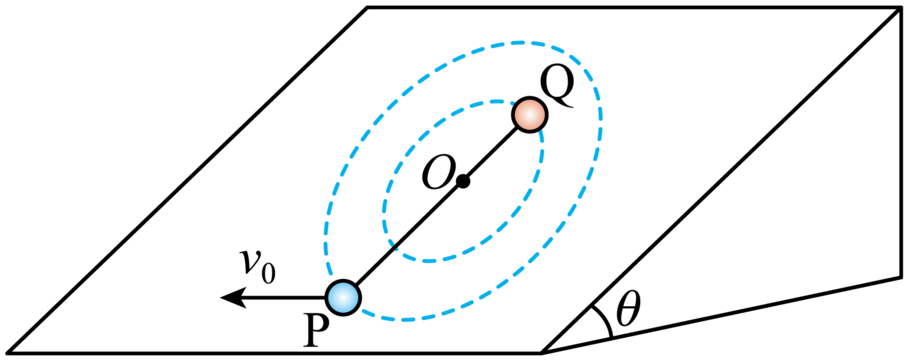

# Physics - 题目 1575

**ID**: ddc3bc1791be461ba5d6273e7d38f9f4
**年级**: Grade 12
**难度**: Medium-Hard
**题型**: Multiple-select

## 题目
如图所示，在倾角 $θ=30{}\degree $ 的光滑固定斜面上固定有一可绕转轴 $O$ 在斜面内自由转动的轻杆，杆的两端分别连接着质量为 $m{{}_{1}}=30{\rm{g}}$ 的小球P和质量为 $m{{}_{2}}=60{\rm{g}}$ 的小球Q，OP的长度 $r{{}_{1}}=0.20{\rm{m}}{\rm ，\mathit{OQ}}$ 的长度 $r{{}_{2}}=0.10{\rm{m}}$ ，重力加速度 $g$ 取 $10{\rm{m}}/{\rm{s}}{^{2}}$ 。​​​​​​​‌现给小球P一个垂直于 $OP$ 且与斜面平行的初速度 $v{{}_{0}}=2.0{\rm{m}}/{\rm{s}}$ ，规定转轴 $O$ 点为零势能点，则此后（      ）

## 解答

1. 两球运动过程中，只有重力做功系统机械能守恒。依题意，两球角速度相同，根据 $v=ωr$ ，可知二者线速度关系为 $\frac {v{{}_{1}}}{v{{}_{2}}}=\frac {r{{}_{1}}}{r{{}_{2}}}=2$ ，小球P刚获得速度时，系统的机械能为 $E=\frac {1}{2}m{{}_{1}}v{{}_{1}^{2}}+\frac {1}{2}m{{}_{2}}v{{}_{2}^{2}}+m{{}_{2}}gr{{}_{2}}\sin 30{}\degree -m{{}_{1}}gr{{}_{1}}\sin 30{}\degree $ ，联立，解得 $E=0.09{\rm{J}}$ ，系统机械能不变恒为 $0.09{\rm{J}}$ 。A正确；当轻杆转至水平位置时，由机械能守恒，可得 $E=\frac {1}{2}m{{}_{1}}v{{}_{1}^{^{′}2}}+\frac {1}{2}m{{}_{2}}v{{}_{2}^{^{′}2}}$ ，又 $\frac {v^{′}{{}_{1}}}{v^{′}{{}_{2}}}=2$ ，此时轻杆对球P的弹力与重力下滑分力的合力提供向心力，有 $F{{}_{向}}=m{{}_{1}}\frac {v{{}_{1}^{^{′}2}}}{r{{}_{1}}}$ ，且 $F{{}_{弹}}=\sqrt {{\left({m{{}_{1}}g\sin 30{}\degree }\right)^{2}}+F{{}_{向}^{2}}}$ ，联立，解得 $F{{}_{弹}}=0.62{\rm{N}}{\rm ，B}$ 错误；当球Q转至最低点时，有 $E=\frac {1}{2}m{{}_{1}}v^{′′}{{}_{1}^{2}}+\frac {1}{2}m{{}_{2}}v^{′′}{{}_{2}^{2}}-m{{}_{2}}gr{{}_{2}}\sin 30{}\degree +m{{}_{1}}gr{{}_{1}}\sin 30{}\degree $ ，又 $\frac {v^{′′}{{}_{1}}}{v^{′′}{{}_{2}}}=2$ ，由牛顿第二定律，可得 $F{{}_{1}}+m{{}_{1}}g\sin 30{}\degree =m{{}_{1}}\frac {v^{′′}{{}_{1}^{2}}}{r{{}_{1}}}$ ， $F{{}_{2}}-m{{}_{2}}g\sin 30{}\degree =m{{}_{2}}\frac {v^{′′}{{}_{2}^{2}}}{r{{}_{2}}}$ ，联立，解得 $F{{}_{1}}=0.45{\rm{N}}，F{{}_{2}}=0.9{\rm{N}}$ ，所以轻杆对转轴 $O$ 的弹力大小为 $F{{}_{2}}-F{{}_{1}}=0.45{\rm{N}}{\rm ，C}$ 错误；D正确。

## 知识点

**中文**:
  - 共轴转动、皮带传动及齿轮传动问题
  - 绳球模型圆周运动中机械能守恒定律的应用

**English**:
  - Coaxial Rotation, Belt Drive, and Gear Drive Problems
  - String-Ball Circular Motion Models

---
