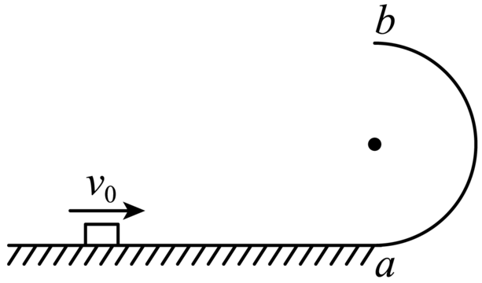

# Physics - 题目 1821

**ID**: e03ba153c9d14190aac59fff47149462
**年级**: Grade 12
**难度**: Medium-Hard
**题型**: Multiple-select

## 题目
如图所示，足够长的光滑水平轨道与竖直固定的光滑半圆形轨道相切于a点，一质量为m的物块 $($ 可视为质点 $)$ ，以大小为 $\bm{υ}$ 的速度水平向右运动，重力加速度为g，不计空气阻力．当半圆形轨道半径取适当值R时，物块从半圆形轨道最高点b飞出后，在水平轨道的落点与a点间距离最大，最大距离为d．则 $($ 　　 $)$​​​​​​​‌

## 解答

1. 设小球经过a点的速度为 $v{{}_{a}}$ ，小球沿着光滑的轨道从b到a的过程只有重力做功，由机械能守恒定律： $-mg\cdot 2R=\frac {1}{2}mv{{}_{a}^{2}}-\frac {1}{2}mv{^{2}}$ ；而小球从a点做平抛运动， $2R=\frac {1}{2}gt{^{2}}$ ， $d=v{{}_{a}}t$ ；联立各式可得： $d=\sqrt {\frac {4R(v{^{2}}-4gR)}{g}}$ ，可知根号下的表达式为R作自变量的二次函数，则当 $4Rg=(v{^{2}}-4gR)$ 时，即 $\mathbf{R}=\frac {v{^{2}}}{8g}$ ，水平距离有最大值 $d{{}_{{\rm \max }}}=\sqrt {\frac {16R{^{2}}g{^{2}}}{g{^{2}}}}=4R=\frac {v{^{2}}}{2g}$ ；故选AC.
2. 【点睛】
3. 本题考查机械能守恒定律与平抛运动规律的应用，要注意明确物理过程，正确选择物理规律结合数学函数求极值的方法准确求解．

## 知识点

**中文**:
  - 平抛运动中的临界问题

**English**:
  - Critical Problems in Horizontal Projectile Motion

---
