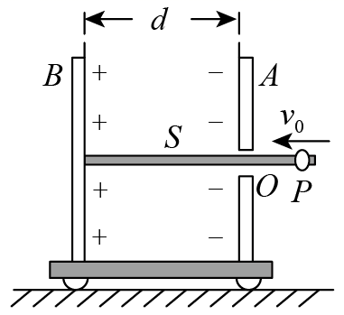

# Physics - 题目 183

**ID**: e37996b5b50b46f28b0e0f78c4de6b9a
**年级**: Grade 12
**难度**: Medium-Hard
**题型**: Multiple-select

## 题目
如图，绝缘座放在光滑水平面上，间距为d的平行板电容器竖直固定在绝缘座上，A板有小孔O，水平绝缘光滑杆穿过O固定在B板上，电容器、底座和绝杆的总质量为M。​​​​​​​‌给电容器充电后，一质量为m的带正电环P套在杆上以某一速度_{ }v_{0}，对准O向左运动，在电容器中P距B板最近的位置为S。OS= $\frac {d}{2}$ 若A、B板外侧无电场，P过孔O时与板无接触，不计P对A、B板间电场的影响。则（      ）

## 解答

1. A．带电圆环进入电场后，在电场力的作用下，做匀减速直线运动，而电容器则在电场力的作用下做匀加速直线运动，当他们速度相等时，带电圆环与电容器的左极板相距最近，取向左为正方向，有系统动量守恒
2. $mv{{}_{0}}=(m+M)v$
3. 可得
4. $v=\frac {mv{{}_{0}}}{m+M}$
5. 则P在S处的速度不为0，故A错误；
6. BC．该过程电容器（绝缘座）向左做匀加速直线运动，有
7. $x=\frac {v}{2}t$
8. 环向左做匀减速直线运动，有
9. $x{^{^{′}}}=\frac {v+v{^{^{′}}}}{2}t$
10. 由题意可知
11. $x{^{^{′}}}-x=\frac {d}{2}$
12. 解得
13. $x{^{^{′}}}=\frac {md}{2(M+m)}$
14. P从O至S的过程中，绝缘座的位移大小为 $\frac {md}{2(M+m)}$ ，故C正确，B错误；
15. D．P从O至S的过程中，带电环减速，动能减少，电容器动能增加，系统动能减少，电势能增加，增加的电势能
16. $\Delta E{{}_{P}}=\frac {1}{2}mv{{}_{0}^{2}}-\frac {1}{2}(m+M)v{^{2}}=\frac {mMv{{}_{0}^{2}}}{2(M+m)}$
17. 故D正确。
18. 故选CD。

## 知识点

**中文**:
  - 电容器与力学知识的综合

**English**:
  - Integration of Capacitors and Mechanics

---
