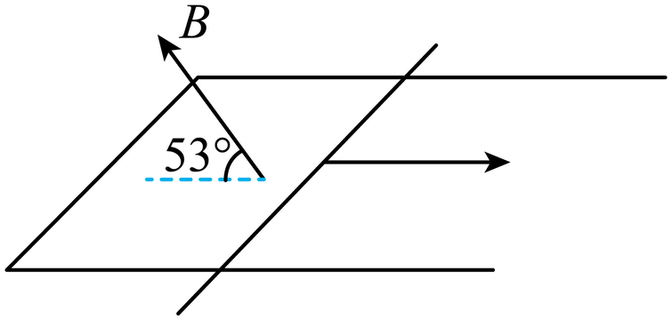

# Physics - 题目 1612

**ID**: e38f3d8b449c47deb747e2972f584262
**年级**: Grade 12
**难度**: Medium-Hard
**题型**: Multiple-select

## 题目
如图所示，质量为m的金属杆垂直放置在足够长的水平导轨上，接入电路的有效长度为L，导轨处在磁感应强度大小为B，方向与导轨所在的平面间夹角为 $53{}\degree $ 斜向上的匀强磁场中，整个回路的电阻恒为R，杆与导轨间的动摩擦因数为0.​​​​​​​‌75，现给金属杆施加水平向右的大小为mg的恒定拉力由静止开始运动，最终匀速运动，重力加速度为g， ${\rm{s}}{\rm{i}}{\rm{n}}37{}\degree =0.6$ ， ${\rm{c}}{\rm{o}}{\rm{s}}37{}\degree =0.8$ ，下列说法正确的是（      ）

## 解答

1. 金属杆产生的感应电动势 $E=BLv\sin 53{}\degree $ ，回路中的感应电流 $I=\frac {E}{R}$ ，金属杆所受安培力 $F{{}_{安}}=BIL$ ，解得 $F{{}_{安}}=\frac {4B{^{2}}L{^{2}}v}{5R}$ ，根据右手定则与左手定则可知安培力斜向左下方与水平方向的夹角成37°，把安培力分别沿水平方向和竖直方向分解，在竖直方向有 $F{{}_{{\rm{N}}}}=F{{}_{安}}\sin 37{}\degree +mg=mg+\frac {12B{^{2}}L{^{2}}v}{25R}$ ，可知，金属杆的速度逐渐增大，最后匀速运动的过程中，支持力先增大后不变，故A错误；当金属杆以速度 $v{{}_{0}}$ 匀速运动时，水平方向上有 $mg=F{{}_{安}}{\cos}37{}\degree +μF{{}_{{\rm{N}}}}$ ，结合上述解得 $v{{}_{0}}=\frac {mgR}{4B{^{2}}L{^{2}}}$ ，故B正确；金属杆克服安培力的功率为 $P=F{{}_{安}}v{\cos}37{^{\circ }}$ ，由于 $F{{}_{安}}=\frac {4B{^{2}}L{^{2}}v}{5R}$ ，解得 $P=\frac {16B{^{2}}L{^{2}}v{^{2}}}{25R}$ ，当速度达到最大值 $v{{}_{0}}$ 时，金属杆克服安培力的功率达到最大值，由于 $v{{}_{0}}=\frac {mgR}{4B{^{2}}L{^{2}}}$ ，解得 $P{{}_{{\rm{m}}}}=\frac {m{^{2}}g{^{2}}R}{25B{^{2}}L{^{2}}}$ ，故C错误；令金属杆从静止到匀速运动的位移为x，感应电动势的平均值 ${\overline{E}}=\frac {ΔΦ}{t}=\frac {B\sin 53{^{\circ }}\cdot Lx}{t}$ ，感应电流的平均值 ${\overline{I}}=\frac {{\overline{E}}}{R}$ ，根据电流的定义式有 ${\overline{I}}=\frac {q}{t}$ ，解得 $q=\frac {ΔΦ}{R}$ ，解得 $q=\frac {4BLx}{5R}$ ，对金属杆进行分析，根据动量定理有 $\left ({mg-μF{{}_{{\rm{N}}}}}\right )t-B{\overline{I}}Lt{\cos}37{}\degree =mv{{}_{0}}$ ，其中 $q={\overline{I}}t$ ， $F{{}_{{\rm{N}}}}=F{{}_{安}}\sin 37{}\degree +mg$ ，则有 $\left ({mg-μF{{}_{{\rm{N}}}}}\right )t=mgt-μ\left ({F{{}_{安}}\sin 37{}\degree +mg}\right )t=\left ({1-μ}\right )mgt-μF{{}_{安}}\sin 37{}\degree \cdot t=\left ({1-μ}\right )mgt-μB{\overline{I}}Lt\sin 37{}\degree $ ，结合上述解得 $t=\frac {4B{^{2}}L{^{2}}x}{mgR}+\frac {mR}{B{^{2}}L{^{2}}}$ ，故D正确。

## 知识点

**中文**:
  - 单杆模型
  - 导体切割磁感线产生感应电动势（电流）的分析与计算

**English**:
  - Single Rod Model
  - Analysis and Calculation of Cutting Magnetic Field Lines

---
