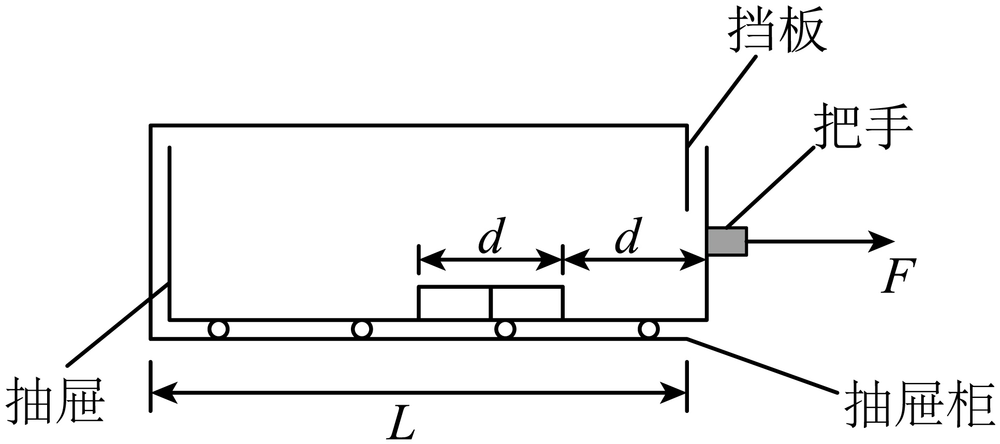

# Physics - 题目 934

**ID**: e395a87b24f440eabc7dd0d744254540
**年级**: Grade 12
**难度**: Medium-Hard
**题型**: Multiple-select

## 题目
如图所示为教师办公室中抽屉使用过程的简图：抽屉底部安有滚轮，当抽屉在柜中滑动时可认为不受抽屉柜的摩擦力，抽屉柜右侧装有固定挡板，当抽屉拉至最右端与挡板相碰时速度立刻变为0。​​​​​​​‌现在抽屉完全未抽出，在中间位置放了一个手机，手机长度 $d=0.2{\rm{m}}$ ，质量 $m=0.2{\rm{k}}{\rm{g}}$ ，其右端离抽屉右侧的距离也为d，手机与抽屉接触面之间的动摩擦因数 $μ=0.1$ ，抽屉总长 $L=0.8{\rm{m}}$ ，质量 $M=1{\rm{k}}{\rm{g}}$ 。不计抽屉左右两侧及挡板的厚度，重力加速度 $g=10{\rm{m}}/{\rm{s}}{^{2}}$ 。现对把手施加水平向右的恒力F，则（      ）

## 解答

1. 手机的最大加速度为 $a{{}_{{\rm{m}}}}=\frac {{\rm μm}g}{m}=μg={\rm l}{\rm{m}}{\rm{/}}{\rm{s}}{^{{{2}}}}$ ，手机与抽屉一起加速运动的最大拉力为 $F{{}_{{\rm{m}}}}=\left ({M+m}\right )a{{}_{{\rm{m}}}}=1.2{\rm{N}}$ ，当水平恒力的大小 $F⩽1{\rm{N}}$ 时，手机与抽屉无相对运动，A错误；当水平恒力的大小F=0.3N时，抽屉和手机一起加速运动的加速度大小为 $a{{}_{1}}=\frac {F}{M+m}=\frac {0.3}{1+0.2}{\rm{m}}{\rm{/}}{\rm{s}}{^{{{2}}}}=0.25{\rm{m}}{\rm{/}}{\rm{s}}{^{{{2}}}}$ ，当抽屉拉至最右端与挡板相碰时 $2a{{}_{1}}L=v{{}_{1}^{2}}$ ，解得 $v{{}_{1}}=\sqrt {0.4}{\rm{m}}{\rm{/}}{\rm{s}}$ ，抽屉停止运动后，手机向右滑动，则 $v{{}_{1}^{2}}=2a{{}_{{\rm{m}}}}x{{}_{1}}$ ，解得手机向右滑动的位移大小为 $x{{}_{1}}=0.2{\rm{m}}=d$ ，手机恰好不与抽屉右侧发生磕碰；当水平恒力的大小F⩽0.3N时，手机不与抽屉右侧发生磕碰，B正确；当 $F>1.2{\rm{N}}$ 时手机与抽屉相对滑动，水平恒力的大小F=1.8N时，对抽屉由牛顿第二定律得 $F-{\rm μm}g=Ma{{}_{2}}$ ，解得 $a{{}_{2}}=1.6{\rm{m}}{\rm{/}}{\rm{s}}{^{{{2}}}}$ ，当抽屉拉至最右端与挡板相碰时 $L=\frac {1}{2}a{{}_{2}}t{{}_{2}}$ ，解得 $t{{}_{2}}=1{\rm{s}}$ ，手机的速度为 $v{{}_{2}}=a{{}_{m}}t{{}_{2}}=1{\rm{m}}{\rm{/}}{\rm{s}}$ ，手机的位移为 $x{{}_{2}}=\frac {v{{}_{2}}}{2}t{{}_{2}}=0.5{\rm{m}}$ ，抽屉停止运动后手机向右滑动的位移 $x{{}_{3}}=x{{}_{2}}=0.5{\rm{m}}$ ，则 $x{{}_{2}}+x{{}_{3}}=L+d$ ，则手机恰好与抽屉右侧不磕碰，所以为使手机不与抽屉右侧发生磕碰，水平恒力的大小可满足F⩾1.8N，C正确；恰好与左端相碰时，对抽屉由牛顿第二定律得 $F-{\rm μm}g=Ma{{}_{3}}$ ，当抽屉拉至最右端与挡板相碰时 $L=\frac {1}{2}a{{}_{3}}t{{}_{3}}{^{2}}$ ，手机向右运动的位移大小为 $x{{}_{4}}=\frac {1}{2}a{{}_{{\rm{m}}}}t{{}_{3}^{2}}$ ，则 $x{{}_{4}}=L-2d$ ，解得 $F=2.2{\rm{N}}$ ，手机恰好不与抽屉左侧发生磕碰，所以为使手机不与抽屉左侧发生磕碰，水平恒力的大小必定满足F⩽2.2N，D错误。

## 知识点

**中文**:
  - 功和功率
  - 连接体问题（整体和隔离法）、临界问题

**English**:
  - Work and Power
  - Connected Bodies Problems (Whole/Isolation Method), Critical Problems

---
