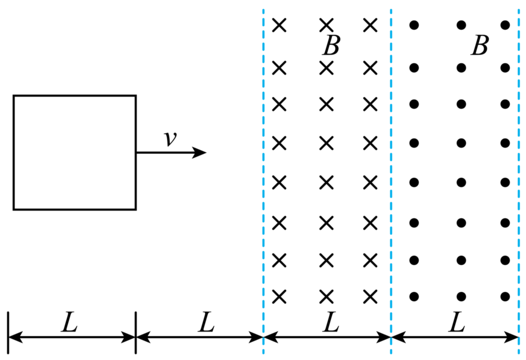

# Physics - 题目 259

**ID**: e6bbd7792c5246d5a96a30dd428c70ee
**年级**: Grade 12
**难度**: Medium-Hard
**题型**: Multiple-select

## 题目
如图所示的两个有界匀强磁场，磁感应强度大小均为B，方向分别垂直纸面向里和向外，磁场宽度均为L．距磁场区域的左侧L处，有一边长为L的正方形导体线框，总电阻为R，且线框平面与磁场方向垂直．现用拉力F使线框以速度v匀速穿过磁场区域，以初始位置为计时起点，规定电流沿逆时针方向时电动势E为正，拉力F向右为正．关于感应电动势E、线框中通过的电荷量q、拉力F和产生的热功率P随时间t变化的图像正确的有（      ）​​​​​​​‌

## 解答

1. 当线圈进入第一个磁场时，产生的感应电动势为E=BLvE保持不变，根据楞次定律可知，感应电流是逆时针，而线圈开始进入第二个磁场时，两端同时切割磁感线，电动势应为E=2BLv，根据楞次定律可知，感应电流是顺时针，，当线圈离开第二个磁场时，产生的感应电动势为E=BLv，根据楞次定律可知，感应电流是逆时针，故A正确；根据法拉第电磁感应定律得 $E=\frac {ΔΦ}{Δt}$  ①
2. 根据闭合电路欧姆定律得 $\bar I=\frac {\bar E}{R+r}$  ②
3. 线框中通过的电荷量 $q=\bar It$  ③
4. 由①②③式解得线框中通过的电荷量 $q=\frac {NΦ}{R+r}$ ，可知，线框中通过的电荷量与磁通量成正比。当线框运动L时开始进入磁场，磁通量开始增加，线框中通过的电荷量增大；当全部进入时达最大，线框中通过的电荷量最大；；此后向外的磁通量增加，总磁通减小，线框中通过的电荷量减小；；当运动到2.5L时，磁通量最小为0，线框中通过的电荷量也为0，故B错误；拉力的功率P=Fv，因速度不变，而在线框在第一个磁场时，电流为定值，拉力为定值，外力F的功率也为定值；两边分别在两个磁场中时，感应电动势为E=2BLv，外力等于安培力，为 $F=2BIL=2B\frac {2BLv}{R}L=\frac {4B{^{2}}L{^{2}}v}{R}$ ，外力的功率为 $P=Fv=\frac {4B{^{2}}L{^{2}}v{^{2}}}{R}$ ，拉力和功率都变为4倍；此后从第二个磁场中离开时，安培力应等于线框在第一个磁场中的安培力，外力的功率也等于在第一个磁场中的功率，故D正确，C错误。

## 知识点

**中文**:
  - 电磁感应定律中的图像问题

**English**:
  - Graph Problems in EM Induction

---
