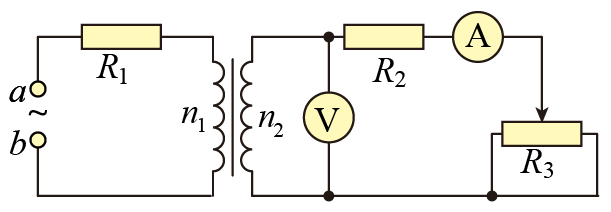

# Physics - 题目 356

**ID**: ecfb4acae01e47a8bde3f1682da923bd
**年级**: Grade 12
**难度**: Medium-Hard
**题型**: Multiple-select

## 题目
如图所示，理想变压器原、副线圈的匝数比n_{1}：n_{2}＝1∶2，定值电阻R_{1}＝R_{2}＝5Ω，滑动变阻器R_{3}的最大阻值为80Ω，电流表、电压表均为理想电表。​​​​​​​‌a、b两端接入电压为u＝220 $\sqrt {2}$ sin100πt（V）的交变电流，则滑动变阻器的滑片缓慢地从左端向右端滑动的过程中，下列说法正确的是（      ）

## 解答

1. A．根据ab两端接入电压为u＝220 $\sqrt {2}$ sin100πt，交流电的角速度为ω＝100πrad/s，则周期
2. T＝ $\frac {2π}{ω}=\frac {2π}{100π}{\rm{s}}=0.02{\rm{s}}$
3. 在一个周期内电流方向改变2次，故每秒钟电流改变次数为
4. n＝ $2\times \frac {1}{T}$ ＝ $2\times \frac {1}{0.02}$ ＝100
5. 故A错误；
6. B．将原副线圈及副线圈电路等效为原线圈的一个电阻 $R^{′}$ ，由
7. $U{{}_{1}}=I{{}_{1}}R^{′}$
8. $U{{}_{1}}{\rm{=}}\frac {n{{}_{1}}}{n{{}_{2}}}U{{}_{2}}$
9. $I{{}_{1}}=\frac {n{{}_{2}}}{n{{}_{1}}}I{{}_{2}}$
10. $U{{}_{2}}=I{{}_{2}}R{{}_{副}}$
11. 联立可得
12. $R^{′}=（\frac {n{{}_{1}}}{n{{}_{2}}}）{^{2}}R{{}_{副}}$
13. 滑动变阻器的滑片缓慢地从左端向右端滑动的过程中，副线圈回路中的总电阻 $R{{}_{副}}$ 先增大后减小，则原线圈回路的等效电阻先增大后减小，由
14. $I{{}_{1}}{\rm{=}}\frac {U}{R{{}_{1}}+R^{′}}$
15. 知原线圈中电流先减小后增大，由 $I{{}_{1}}=\frac {n{{}_{2}}}{n{{}_{1}}}I{{}_{2}}$ 知，副线圈中电流先减小后增大，故B正确；
16. C．原线圈电路中电流先减小后增大，根据 $P=I{{}_{1}^{2}}R{{}_{1}}$ 可知电阻R_{1}的功率先减小后增大，故C错误；
17. D．设副线圈中的电流为I_{2}，根据 $\frac {I{{}_{1}}}{I{{}_{2}}}=\frac {n{{}_{2}}}{n{{}_{1}}}$ 可知I_{1}＝2I_{2}，故
18. U_{1}＝U﹣I_{1}R_{1}＝（220﹣10I_{2}）V
19. 输入功率
20. P_{入}＝U_{1}I_{1}＝（220﹣10I_{2}）×2I_{2}＝﹣20（I_{2}﹣11）^{2}+2420
21. 当I_{2}＝11A时，此时输入功率最大，最大为
22. P_{入}_{max}＝2420W
23. 故D正确。
24. 故选BD。

## 知识点

**中文**:
  - 含有理想变压器的动态电路分析

**English**:
  - Dynamic Circuit Analysis with Ideal Transformers

---
