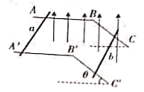

# Physics - 题目 811

**ID**: ed2174a35712436c84cac20544c42b84
**年级**: Grade 12
**难度**: Medium-Hard
**题型**: Multiple-select

## 题目
如图所示，间距为l的两足够长的平行光滑金属轨道间有方向竖直向上的匀强磁场，轨道 $AB-A^{′}B^{′}$ 部分水平，倾斜轨道 $BC-B^{′}C^{′}$ 部分与水平面的夹角为 $θ$ ，质量均为m、电阻均为R的金属棒a、b分别垂直放置在水平轨道和斜轨道上（与轨道接触良好）。​​​​​​​‌现用一水平向左的外力F作用在金属棒a上，使金属棒a以速度v_{0}做匀速运动，此时金属棒b恰好能静止在倾斜轨道上。已知重力加速度为g，导轨电阻不计。则（      ）

## 解答

1. AB．a棒在拉力作用下向左运动，由右手定则可知，b中有向外的电流，对b受力分如图所示，由平衡可得
2. $F{{}_{{\rm{A}}}}=mg{\tan}θ$
3. b棒所受安培力为
4. $F{{}_{{\rm{A}}}}=BIl$
5. 回路中的电流为
6. $I{\rm{=}}\frac {E}{2R}{\rm{=}}\frac {Blv{{}_{0}}}{2R}$
7. 联立解得
8. $B=\sqrt {\frac {2mgR{\tan}θ}{l{^{2}}v{{}_{0}}}}$
9. 棒a匀速运动由平衡有
10. $F=BIl=F{{}_{{\rm{A}}}}=mg{\tan}θ$
11. 故A错误，B正确；
12. C．由b棒受力图由平衡可知
13. $F{{}_{{\rm{N}}}}=\frac {mg}{{\cos}θ}$
14. 由牛顿第三定律可得金属棒b对轨道的压力大小为 $\frac {mg}{{\cos}θ}$ ，故C错误；
15. D．由能量关系可知
16. $P{{}_{F}}{\rm{=}}P{{}_{a}}+P{{}_{b}}=2P{{}_{a}}$
17. 即
18. $mgv{{}_{0}}{\tan}θ=2P{{}_{a}}$
19. 得
20. $P{{}_{a}}=\frac {mgv{{}_{0}}{\tan}θ}{2}$
21. 故D正确。
22. 故选BD。
23. 

## 知识点

**中文**:
  - 安培力的大小
  - 导体切割磁感线产生感应电动势（电流）的分析与计算

**English**:
  - Magnitude of Ampere Force
  - Analysis and Calculation of Cutting Magnetic Field Lines

---
